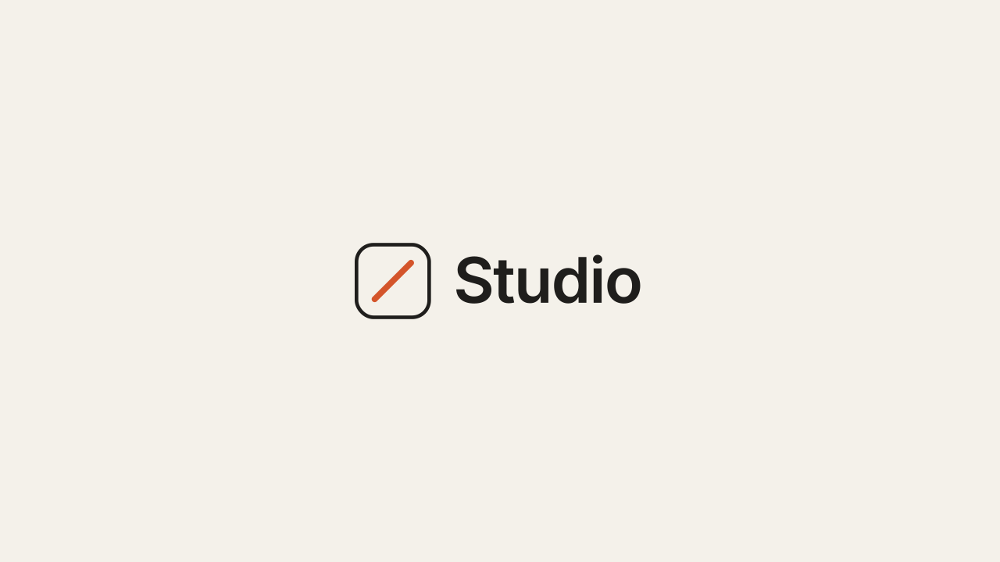

# 01 · Line-Draw Preloader

A sitewide loading screen that draws the client's logo: open lines stroke in,
filled shapes trace their outline and then ink in, and an accent element pulses
while the page finishes loading.
Version **1.0.0** · Status: **beta: tested in real Chrome on a mock 7.1 page; not yet on a live site**



---

# Part 1 — Basic install

## Overview

- Plays once per visit (per browser tab session), then every page loads instantly.
- Works with **any outlined SVG logo**. The script measures each shape itself, so
  there are no path lengths to calculate.
- Waits for the page to load **and** for the intro to finish, so the logo never
  gets cut off mid-draw.
- Fail-safe: it always leaves after 8 seconds, even if a request hangs.
- Never runs inside the Squarespace editor.
- Visitors with "reduce motion" on see the finished logo and a fast exit.
- Removes itself from the page when done. No scroll lock is left behind.

Requires the **Core plan or higher** (Code Injection).

## Step 1 — Installation

Settings → Developer Tools → Code Injection → **Header**. Paste
[`snippets/header-injection.html`](snippets/header-injection.html).

Header, not Footer: the cover must be on screen from the first paint, or
visitors see a flash of the page first.

## Step 2 — Swap in the client logo

The snippet ships with a placeholder "Studio" lockup. Replace the `<svg>…</svg>`
inside `<template id="swtl-ld-markup">` with the client's logo.

1. Export the logo as SVG with **text converted to outlines**.
2. Remove any `<style>` block and `class="cls-…"` names from the export
   (Illustrator class names collide across files). Put colors on the shapes
   as `fill="#…"` / `stroke="#…"` instead.
3. Add `class="swtl-ld-mark"` to the `<svg>` tag so it gets the size rule.
4. Optional: add `data-pulse` to one shape (an accent, a dot, a slash) to make
   it pulse while the page loads.
5. Optional: add `data-skip` to any shape that should just appear with no draw.

**Draw order = the order of the shapes in the SVG.** Move an element up or down
in the code to change when it draws. Shapes with `fill="none"` draw as lines;
filled shapes trace then ink.

## Step 3 — Test

- Open the site in a private window → the full sequence plays.
- Click to a second page → no preloader (once per session).
- Add `?nopreloader` to any URL to skip it while you work.

## Settings (optional)

Paste this **above** the snippet in the same Header box to change behavior
without touching the code:

```html
<script>
  window.SwtlLineDraw = {
    minShow: 'auto',      // ms on screen, or 'auto' = intro + ~1s hold
    maxWait: 8000,        // ms fail-safe
    oncePerSession: true, // false = play on every page load
    speed: 1              // 1.25 = 25% faster, 0.8 = slower
  };
</script>
```

---

# Part 2 — Styling

Colors come from three CSS variables shared by every SWTL motion preset. Set
them once in **Design → Custom CSS**:

```css
:root {
  --swtl-paper: #F4F1EA;   /* loader background */
  --swtl-ink: #1F1E1C;     /* placeholder lines + letters */
  --swtl-accent: #D4552B;  /* placeholder slash */
  --swtl-ld-size: min(360px, 64vw);  /* logo width */
}
```

To follow the site's own theme colors instead, use Squarespace's variables:

```css
:root {
  --swtl-paper: hsl(var(--white-hsl));
  --swtl-accent: hsl(var(--accent-hsl));
}
```

A client logo with its own `fill` colors keeps them; the variables only style
the placeholder classes.

---

# Part 3 — For developers

| Item | Value |
|---|---|
| Namespace | `swtl-ld-` (ids, classes, keyframes) · sessionStorage key `swtlLdShown` |
| Lifecycle | instant cover → mount on DOMContentLoaded → animate → dismiss on `load` + `minShow` → fail-safe `maxWait` → fade 0.55s → node removed |
| Timing | start delay 0.20s · stagger `min(0.22, 1.8 / (n-1))` · stroke draw 0.9s · trace 0.5s · ink 0.4s from +0.32s · pulse 2.4s |
| Easing | draw `cubic-bezier(.65,0,.35,1)` · ink `cubic-bezier(.22,1,.36,1)` |
| Editor guard | exits when `window.self !== window.top` (the editor frames the site) |
| Size | ~11 KB with the placeholder; most of that is the outlined wordmark |
| Dependencies | none (no GSAP, no fonts, no network requests) |

Files: `mark.py` (placeholder geometry + timing, shared with the video),
`snippet.template.html` → `build_snippet.py` → `snippets/header-injection.html`,
`scene.py` (video), `checks.py` (8 timed frame checks),
`browser.test.mjs` (11 real-Chrome checks).

---

# Part 4 — Support

## Troubleshooting

| Problem | Fix |
|---|---|
| Logo draws as dotted lines | Not possible in the browser version (lengths are measured). If you see it in a video export, the scene needs real path lengths. |
| Letters draw but look bold at the end | The trace stroke fades out with the ink. If your logo already has a `stroke`, add `data-skip` or remove the stroke. |
| Logo is huge / tiny | Set `--swtl-ld-size`. |
| Nothing happens | You are logged in and viewing inside the editor frame, or the session flag is set. Use a private window. |
| Page flashes before the loader | The snippet is in the Footer. Move it to the Header. |

## Deployed on

— (not yet)
