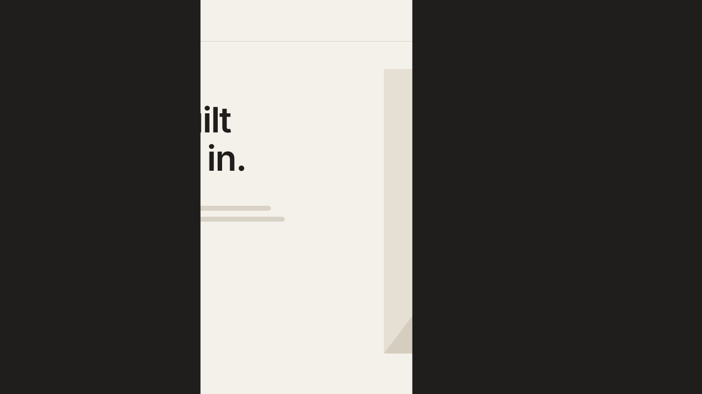

# 02 · Split-Panel Preloader

A sitewide loading screen built from solid panels. The logo rises in, a thin
accent line runs under it while the page loads, then the logo lifts away and
the panels slide apart to reveal the site.
Version **1.0.0** · Status: **beta: tested in real Chrome on a mock 7.1 page; not yet on a live site**



---

# Part 1 — Basic install

## Overview

- Plays once per visit (per browser tab session), then every page loads instantly.
- Two vertical halves by default. You can set more panels, or stack them so
  they part up and down.
- Works with **any SVG logo**. There is no draw step, so the logo does not
  need to be outlined line art.
- Waits for the page to load **and** for the accent line to finish.
- Fail-safe: it always leaves after 8 seconds, even if a request hangs.
- Never runs inside the Squarespace editor.
- Visitors with "reduce motion" on see the logo and a short fade. The panels do not move.
- Removes itself from the page when done. No scroll lock is left behind.

Requires the **Core plan or higher** (Code Injection).

## Step 1 — Installation

Settings → Developer Tools → Code Injection → **Header**. Paste
[`snippets/header-injection.html`](snippets/header-injection.html).

Header, not Footer: the cover must be on screen from the first paint, or
visitors see a flash of the page first.

## Step 2 — Swap in the client logo

The snippet ships with a placeholder "Studio" lockup in the paper color.
Replace the `<svg>…</svg>` inside `<template id="swtl-sp-markup">` with the
client's logo.

1. Export the logo as SVG. A light or reversed version works best on the dark panels.
2. Remove any `<style>` block and `class="cls-…"` names from the export
   (Illustrator class names collide across files). Put colors on the shapes
   as `fill="#…"` / `stroke="#…"` instead.
3. Add `class="swtl-sp-mark"` to the `<svg>` tag so it gets the size rule.
4. Optional: to let the logo follow `--swtl-sp-logo`, add
   `class="swtl-sp-fill"` to filled shapes and `class="swtl-sp-line"` to
   outline shapes, and remove their own colors.

## Step 3 — Test

- Open the site in a private window → the full sequence plays.
- Click to a second page → no preloader (once per session).
- Add `?nopreloader` to any URL to skip it while you work.

## Settings (optional)

Paste this **above** the snippet in the same Header box to change behavior
without touching the code:

```html
<script>
  window.SwtlSplitPanel = {
    panels: 2,              // number of panels (2 = halves)
    direction: 'vertical',  // 'vertical' = part left/right, 'horizontal' = part up/down
    minShow: 'auto',        // ms on screen, or 'auto' = line run + short hold (~2.2s)
    maxWait: 8000,          // ms fail-safe
    oncePerSession: true,   // false = play on every page load
    speed: 1                // 1.25 = 25% faster, 0.8 = slower
  };
</script>
```

| Panels | Vertical | Horizontal |
|---|---|---|
| 2 | left and right halves part sideways | top and bottom halves part up/down |
| 3+ | outer panels leave by the nearer edge; an odd middle panel drops down | outer panels leave by the nearer edge; an odd middle panel slides right |

---

# Part 2 — Styling

Colors come from three CSS variables shared by every SWTL motion preset. Set
them once in **Design → Custom CSS**:

```css
:root {
  --swtl-ink: #1F1E1C;     /* panel color */
  --swtl-paper: #F4F1EA;   /* placeholder logo color */
  --swtl-accent: #D4552B;  /* hairline + placeholder slash */
  --swtl-sp-size: min(240px, 56vw);  /* logo and hairline width */
  --swtl-sp-panel: #1F1E1C;          /* optional: panel color for this preset only */
  --swtl-sp-logo: #F4F1EA;           /* optional: logo color for this preset only */
}
```

To follow the site's own theme colors instead, use Squarespace's variables:

```css
:root {
  --swtl-ink: hsl(var(--black-hsl));
  --swtl-accent: hsl(var(--accent-hsl));
}
```

A client logo with its own `fill` colors keeps them; the variables only style
the placeholder classes.

---

# Part 3 — For developers

| Item | Value |
|---|---|
| Namespace | `swtl-sp-` (ids, classes, keyframes, CSS vars) · sessionStorage key `swtlSpShown` · config `window.SwtlSplitPanel` |
| Lifecycle | instant `html::before` cover → mount on DOMContentLoaded → intro → dismiss on `load` + `minShow` → fail-safe `maxWait` → logo out + panels part → node removed |
| Timing | logo in 0.6s from 0.15s (14px rise) · hairline 1.5s from 0.55s · hold 0.1s · dismiss at 2.15s · logo out 0.3s · panels 0.9s from +0.15s, stagger 0.08s · reveal done ~3.3s · hold pulse 2.4s if the page is still loading |
| Easing | panels `cubic-bezier(.77,0,.18,1)` · logo in `cubic-bezier(.22,1,.36,1)` · hairline `cubic-bezier(.65,0,.35,1)` · logo out `cubic-bezier(.55,0,1,.45)` |
| Motion | `transform` and `opacity` only. Panels overlap by 1px so no seam shows. |
| Editor guard | exits when `window.self !== window.top` (the editor frames the site) or `body.sqs-edit-mode-active` / `body.sqs-is-page-editing` |
| Reduced motion | no intro animation, 0.4s show, 0.2s fade, panels never move |
| Size | ~13 KB with the placeholder; ~4 KB of that is the outlined wordmark |
| Dependencies | none (no GSAP, no fonts, no network requests) |

Files: `mark.py` (placeholder geometry, timing and easing curves, shared with
the video), `snippet.template.html` → `build_snippet.py` →
`snippets/header-injection.html`, `scene.py` (video), `checks.py` (8 timed
frame checks), `browser.test.mjs` (26 real-Chrome checks, incl. a
3-panel horizontal config run).

---

# Part 4 — Support

## Troubleshooting

| Problem | Fix |
|---|---|
| Logo is invisible | The client logo is dark on dark panels. Use a reversed version or set `--swtl-sp-panel` to a light color. |
| A thin line shows between panels | A browser zoom rounding edge case. The panels already overlap by 1px; set `panels: 2` if you use an odd count. |
| Logo is huge / tiny | Set `--swtl-sp-size`. The hairline follows it. |
| Nothing happens | You are logged in and viewing inside the editor frame, or the session flag is set. Use a private window. |
| Page flashes before the loader | The snippet is in the Footer. Move it to the Header. |

## Deployed on

— (not yet)
