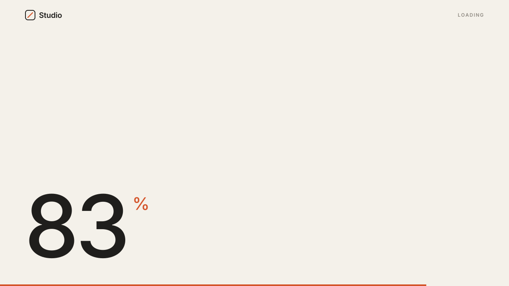

# 03 · Counter Preloader

A sitewide loading screen with a large 0–100 counter in the bottom-left and a
thin accent progress bar along the bottom edge. The counter is honest: it eases
toward ~90 while the page loads and only finishes to 100 once the page has
actually loaded. Then the digits roll up and the screen wipes away.
Version **1.0.0** · Status: **beta: tested in real Chrome on a mock 7.1 page; not yet on a live site**



---

# Part 1 — Basic install

## Overview

- Plays once per visit (per browser tab session), then every page loads instantly.
- The counter never claims 100 before the page is ready. On a slow connection
  it parks in the high 80s and waits; on a fast one it runs straight through.
- The numerals use **the site's own font** (no web fonts are loaded), with
  equal-width figures so the number does not jitter as it counts.
- Fail-safe: it always completes after 8 seconds, even if a request hangs.
- Never runs inside the Squarespace editor.
- Visitors with "reduce motion" on see no counting and a short fade.
- Removes itself from the page when done. No scroll lock is left behind.

Requires the **Core plan or higher** (Code Injection).

## Step 1 — Installation

Settings → Developer Tools → Code Injection → **Header**. Paste
[`snippets/header-injection.html`](snippets/header-injection.html).

Header, not Footer: the cover must be on screen from the first paint, or
visitors see a flash of the page first.

## Step 2 — Swap in the client logo

The snippet ships with a small placeholder "Studio" wordmark in the top-left.
Inside `<template id="swtl-ct-markup">`, replace the contents of
`<div class="swtl-ct-logo">` with the client's logo:

- Simplest: an `` using the logo URL
  from the Squarespace asset library.
- Or an inline `<svg>` with the text converted to outlines.

To change the word in the top-right, edit `<div class="swtl-ct-label">Loading</div>`
(or delete that line).

## Step 3 — Test

- Open the site in a private window → the full sequence plays.
- Click to a second page → no preloader (once per session).
- Add `?nopreloader` to any URL to skip it while you work.

## Settings (optional)

Paste this **above** the snippet in the same Header box to change behavior
without touching the code:

```html
<script>
  window.SwtlCounter = {
    minShow: 1800,        // ms — the counter may not reach 100 before this
    maxWait: 8000,        // ms fail-safe
    oncePerSession: true, // false = play on every page load
    crawlTo: 90           // % the counter creeps toward while waiting
  };
</script>
```

---

# Part 2 — Styling

Colors come from three CSS variables shared by every SWTL motion preset. Set
them once in **Design → Custom CSS**:

```css
:root {
  --swtl-paper: #F4F1EA;   /* loader background */
  --swtl-ink: #1F1E1C;     /* counter + wordmark */
  --swtl-accent: #D4552B;  /* progress bar + % sign */
  --swtl-ct-size: clamp(96px, 17vw, 220px);  /* counter size */
  --swtl-ct-bar-h: 4px;    /* progress bar thickness */
}
```

To follow the site's own theme colors instead, use Squarespace's variables:

```css
:root {
  --swtl-paper: hsl(var(--white-hsl));
  --swtl-accent: hsl(var(--accent-hsl));
}
```

The counter uses the site's body font. To use the heading font instead, add
`#swtl-ct-preloader .swtl-ct-count { font-family: var(--heading-font-font-family); }`.

**Why a bottom bar and not a fill behind the logo:** the bar spans the full
width, so progress reads at a glance even at the edge of vision, and it becomes
the leading edge of the exit wipe. A fill behind the logo depends on the
client's logo shape and size, and a small wordmark makes a weak fill.

---

# Part 3 — For developers

| Item | Value |
|---|---|
| Namespace | `swtl-ct-` (ids, classes, CSS variables) · sessionStorage key `swtlCtShown` · config `window.SwtlCounter` |
| Lifecycle | instant cover → mount on DOMContentLoaded → rAF counter → ready on `load` + `minShow` (or `maxWait`) → finish to 100 → roll out → wipe up 0.75s → node removed |
| Counter | waiting: `crawlTo * (1 - e^(-t / 0.9s))` · ready: from current value to 100 in 0.6s, power3.out · integer text, bar `scaleX` |
| Exit | hold 0.25s · digits `translateY(-110%)` inside a `clip-path` box, chrome fades, 0.5s · overlay `translateY(-100%)` from +0.15s, 0.75s · both `cubic-bezier(.7,0,.2,1)` |
| Reduced motion | counter shows 0, no counting, 0.4s fade; removed ~0.9s after mount |
| Editor guard | exits when `window.self !== window.top` (the editor frames the site) |
| Accessibility | overlay is `aria-hidden="true"`; the number is decorative |
| Size | 8.0 KB |
| Dependencies | none (no GSAP, no fonts, no network requests) |

Files: `timing.py` (curve + timing, shared with the video),
`snippet.template.html` → `build_snippet.py` → `snippets/header-injection.html`,
`scene.py` (video; simulates `load` at 2.6s so the honest park shows),
`checks.py` (9 timed frame checks), `browser.test.mjs` (25 real-Chrome checks,
including a slow page that holds `load` open for 4s).

---

# Part 4 — Support

## Troubleshooting

| Problem | Fix |
|---|---|
| Counter sits in the 80s for a long time | The page really is still loading (a large video or image). It completes at `load`, or at `maxWait` at the latest. |
| Counter runs too fast on a quick site | Raise `minShow` (e.g. 2600). |
| Numbers jump sideways while counting | The site font has no tabular figures. Set the counter to a font that does (see Part 2). |
| Counter is huge / tiny | Set `--swtl-ct-size`. |
| Nothing happens | You are logged in and viewing inside the editor frame, or the session flag is set. Use a private window. |
| Page flashes before the loader | The snippet is in the Footer. Move it to the Header. |

## Deployed on

— (not yet)
