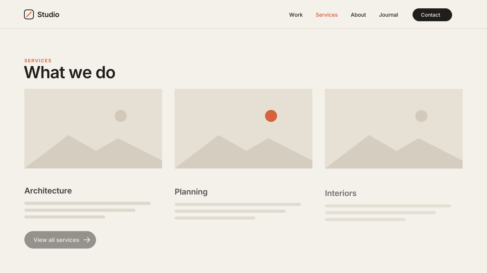

# 04 · Staggered Block Rise

When a section scrolls into view, its blocks rise a short distance and fade in,
one after another, in reading order: the top row first, left to right.
Version **1.0.0** · Status: **beta: tested in real Chrome on a mock 7.1 page; not yet on a live site**



---

# Part 1 — Basic install

## Overview

- Works on **Fluid Engine** sections. Every block (text, image, button, etc.)
  becomes one step in the sequence.
- Follows the order you **see**, not the order you added blocks in. The
  script measures where each block sits on screen.
- Plays once per page view. Scrolling back up does not hide anything again.
- Blocks already on screen at load start right away.
- Never runs inside the Squarespace editor. If you open the editor on a live
  page, it removes everything it added, so every block stays editable and
  resizable.
- Visitors with "reduce motion" on see the page as normal, with no motion.
- If the script fails or is blocked, all content shows as normal.

Requires the **Core plan or higher** (Code Injection).

## Step 1 — Installation

Settings → Developer Tools → Code Injection → **Footer**. Paste
[`snippets/footer-injection.html`](snippets/footer-injection.html).

Footer, not Header: this is an in-page effect, so it runs after the page
content exists.

## Step 2 — Choose the sections

**Per section (default).** In each section you want to animate, add a
**Code Block** and paste
[`snippets/code-block-marker.html`](snippets/code-block-marker.html):

```html
<div data-swtl-rise hidden></div>
```

The block shows nothing on the live site. Make it small and put it in a
corner of the section. It never animates itself.

**Whole site.** Paste this **above** the snippet in the Footer box instead:

```html
<script>window.SwtlBlockRise = { allSections: true };</script>
```

The first section on each page (usually the hero) is left alone. To exclude
another section, add a marker Code Block set to off:
`<div data-swtl-rise="off" hidden></div>`.

## Step 3 — Test

- Open the page in a private window and scroll to the section → the blocks
  rise in reading order.
- Reload with the section already on screen → it plays at once.
- Open the editor → every block is visible and can be moved and resized.

## Settings (optional)

Paste this **above** the snippet in the same Footer box:

```html
<script>
  window.SwtlBlockRise = {
    allSections: false,   // true = every section on every page
    skipFirst: true,      // with allSections: leave the hero section alone
    distance: 28,         // px the blocks rise
    duration: 0.8,        // s per block
    stagger: 0.08,        // s between blocks
    maxDelay: 0.9,        // s cap on the stagger for big sections
    easing: 'cubic-bezier(.22,1,.36,1)'
  };
</script>
```

To change one section only, put the values on its marker:

```html
<div data-swtl-rise data-distance="40" data-stagger="0.12" hidden></div>
```

---

# Part 2 — Styling

The effect has no colors of its own. The motion values are CSS variables,
set by the script on each block. Settings (above) are the simple way to
change them. These are the names, if you need them:

| Variable | Default |
|---|---|
| `--swtl-br-distance` | `28px` |
| `--swtl-br-dur` | `0.8s` |
| `--swtl-br-ease` | `cubic-bezier(.22,1,.36,1)` |
| `--swtl-br-delay` | set per block (stagger) |

Short distances (16–32px) feel calm and premium. Over 60px starts to feel
like a slide-in, not a rise.

---

# Part 3 — For developers

| Item | Value |
|---|---|
| Namespace | `swtl-br-` (classes, CSS variables) · marker `data-swtl-rise` · config `window.SwtlBlockRise` |
| Lifecycle | DOMContentLoaded → collect `.fe-block`s of target sections → sort by rendered top (8px row tolerance), then left → add `html.swtl-br-on` + `.swtl-br-block` → IntersectionObserver (`rootMargin 0 0 -8% 0`) → `.swtl-br-in` with per-block delay → after rest, classes and inline vars removed |
| Timing | rise 0.8s · stagger 0.08s within each batch of blocks that enter together · delay cap 0.9s |
| Easing | `cubic-bezier(.22,1,.36,1)` |
| Animates | `opacity` and `transform` only. Never writes height, width or grid placement |
| Editor guard | exits when framed; MutationObserver on `body` class: `sqs-edit-mode-active` / `sqs-is-page-editing` → full teardown, removal → re-init |
| Excluded | the marker's own `.fe-block`, sections inside `footer`, `data-swtl-rise="off"` sections |
| Size | ~7.4 KB unminified |
| Dependencies | none (no GSAP, no network requests) |

Files: `snippets/footer-injection.html`, `snippets/code-block-marker.html`,
`scene.py` (video; simulates the observer with the snippet's values),
`checks.py` (8 timed frame checks), `browser.test.mjs` (21 real-Chrome
checks, including a scrambled-DOM Fluid Engine grid).

---

# Part 4 — Support

## Troubleshooting

| Problem | Fix |
|---|---|
| Nothing animates | No marker in the section, or you are inside the editor frame. Use a private window. |
| Blocks go in a strange order | Two blocks with tops less than 8px apart count as one row and go left to right. Move one of them. |
| A big section takes too long | Lower `stagger`, or lower `maxDelay`. |
| Hero flickers on load with `allSections` | Keep `skipFirst: true`. |
| Content stays hidden | Another script removed `.swtl-br-in`. Remove the conflict or the snippet; content shows again once the snippet is gone. |

## Deployed on

— (not yet)
