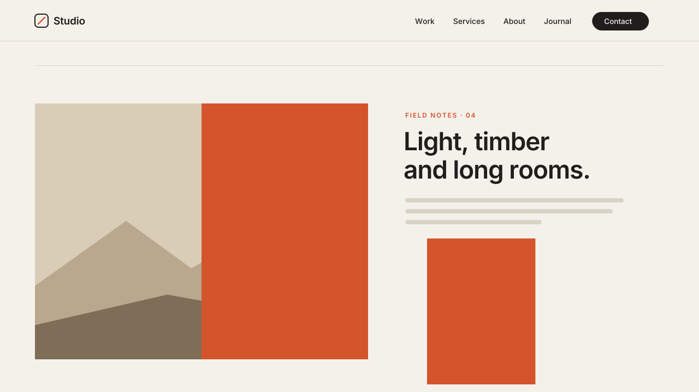

# 05 · Mask / Clip Wipe Reveal

An editorial image reveal: as a section scrolls in, a solid accent curtain
sweeps across each image block, then pulls away and uncovers the photo behind
it while the photo settles from 108% to 100%.
Version **1.0.0** · Status: **beta: tested in real Chrome on a mock 7.1 page; not yet on a live site**



---

# Part 1 — Basic install

## Overview

- Works only on the sections you mark, so the rest of the page is untouched.
- Targets **image blocks** and **video blocks**. Text blocks can opt in to a
  plain clip wipe (no curtain).
- Plays once per block as it scrolls into view. Blocks that enter together
  reveal one after another (0.28s apart).
- The curtain sits inside the block's own box. The block keeps its own size,
  and nothing sets a height or width.
- Never runs inside the Squarespace editor, and tears itself down the moment
  you start editing.
- Visitors with "reduce motion" on see the images right away, with no wipe.
- When a reveal finishes, the script removes its curtain, classes and styles
  from that block.

Requires the **Core plan or higher** (Code Injection).

## Step 1 — Installation

Settings → Developer Tools → Code Injection → **Footer**. Paste
[`snippets/footer-injection.html`](snippets/footer-injection.html).

Footer, not Header: this is an in-page effect. It needs the page content to
exist, and it does nothing until a section asks for it.

## Step 2 — Mark a section

In each section you want to animate, add a **Code Block** (anywhere in the
section, any size) and paste
[`snippets/code-block-marker.html`](snippets/code-block-marker.html):

```html
<div data-swtl-wipe data-direction="right" hidden></div>
```

The Code Block shows nothing on the live site. Every attribute is optional:

| Attribute | Values | Default |
|---|---|---|
| `data-direction` | `right` (left to right), `left`, `down`, `up` | `right` |
| `data-curtain` | `accent`, `ink` | `accent` |
| `data-text` | `true` = text blocks get a plain clip wipe | `false` |
| `data-video` | `false` = leave video blocks alone | `true` |
| `data-stagger` | seconds between blocks that reveal together | `0.28` |

## Step 3 — Test

- Log out (or use a private window) and scroll to the section. Each image
  shows a curtain sweep, then the photo uncovers behind it.
- Open the page editor. Every image must be visible and resizable as normal.
- Turn on "reduce motion" in your OS settings. The images must show at once.

## Settings (optional)

Paste this **above** the snippet in the same Footer box to change the
defaults for every marked section:

```html
<script>
  window.SwtlMaskWipe = {
    direction: 'right',  // right | left | down | up
    curtain: 'accent',   // accent | ink
    text: false,         // true = text blocks get a plain clip wipe
    video: true,         // false = leave video blocks alone
    stagger: 0.28,       // s between blocks that reveal together
    threshold: 0.2       // share of a block on screen before it reveals
  };
</script>
```

Marker attributes override these settings for their own section.

---

# Part 2 — Styling

Colors come from the CSS variables shared by every SWTL motion preset. Set
them once in **Design → Custom CSS**:

```css
:root {
  --swtl-accent: #D4552B;  /* default curtain */
  --swtl-ink: #1F1E1C;     /* curtain with data-curtain="ink" */
  --swtl-mw-curtain: #2B4A3F;  /* optional: curtain color for this preset only */
}
```

To follow the site's own theme colors instead, use Squarespace's variables:

```css
:root {
  --swtl-accent: hsl(var(--accent-hsl));
  --swtl-ink: hsl(var(--black-hsl));
}
```

To give one section its own curtain color, scope the variable to it:

```css
[data-section-id="abc123"] { --swtl-mw-curtain: #E8C66A; }
```

---

# Part 3 — For developers

| Item | Value |
|---|---|
| Namespace | `swtl-mw-` (classes, keyframes, CSS variables) · marker `data-swtl-wipe` · config `window.SwtlMaskWipe` |
| Lifecycle | DOMContentLoaded → find markers → `closest('section.page-section')` → tag blocks + inject one `span.swtl-mw-curtain` into each `.sqs-block-content` → add `html.swtl-mw-on` → IntersectionObserver (threshold 0.2, rootMargin `0 0 -10% 0`, once) → animate → clean the block |
| Timing | curtain in 0.55s → hold 0.07s → out 0.68s (1.30s keyframe) · uncover 0.68s from +0.62s · image scale 1.08 → 1 over 1.2s from +0.62s · text wipe 0.8s · stagger 0.28s |
| Easing | wipes `cubic-bezier(.65,0,.35,1)` · settle `cubic-bezier(.33,1,.68,1)` |
| What moves | `clip-path: inset()` on the children of `.sqs-block-content` and on the curtain; `transform: scale()` on `img` / `video`. No height, width or grid placement is written. The only inline style is the `--swtl-mw-delay` variable, removed after the reveal. |
| Editor guard | exits when framed (`window.self !== window.top`); a MutationObserver on `body` class tears down on `sqs-edit-mode-active` / `sqs-is-page-editing` (removes curtains, classes, the variable and the html class) and re-inits on exit |
| Fail-safe | the hidden state needs `html.swtl-mw-on`, which only the script adds. No script, no IntersectionObserver, reduced motion or framed → content shows as normal. |
| Size | ~7.9 KB unminified |
| Dependencies | none (no GSAP, no fonts, no network requests) |

Files: `timing.py` (timing constants shared by the video and the checks),
`scene.py` (video), `checks.py` (19 timed frame checks, including a check that
the snippet's CSS uses the same numbers as `timing.py`),
`browser.test.mjs` (34 real-Chrome checks).

---

# Part 4 — Support

## Troubleshooting

| Problem | Fix |
|---|---|
| Nothing happens | No marker in the section, or you are viewing inside the editor frame. Log out or use a private window. |
| Only some images animate | Gallery sections and summary blocks are not image blocks. Only `.image-block` / `.video-block` (and opt-in `.html-block`) are targeted. |
| Curtain is the wrong color | Set `--swtl-mw-curtain`, or use `data-curtain="ink"`. |
| Image blocks below the fold stay blank | They reveal when 20% of the block is on screen. A very tall block on a short screen still reaches 20%; if you set `threshold` higher, keep it at 0.5 or lower. |
| Card-style image blocks look cropped during the wipe | Expected: the wipe clips everything inside the block, captions included. It clears when the reveal ends. |

## Deployed on

— (not yet)
