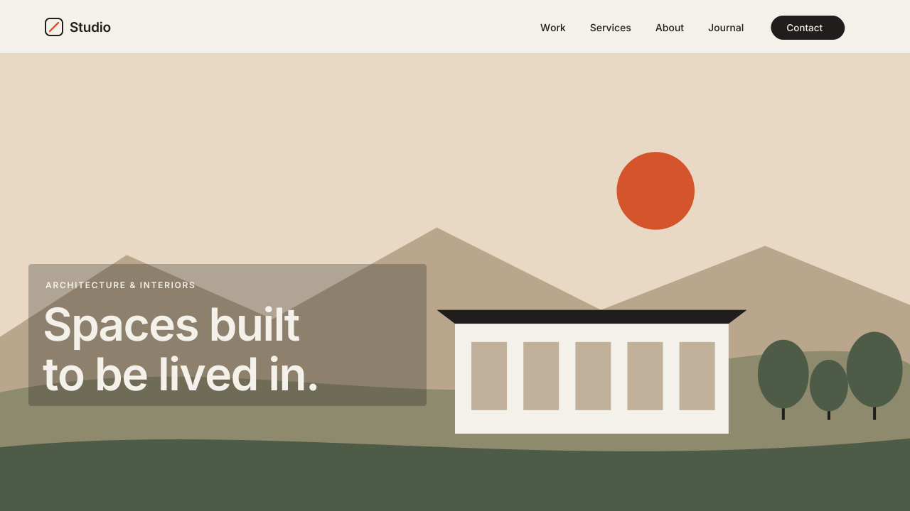

# 06 · Image Scale-Settle

A cinematic image entrance. Each image in a marked section starts a little
zoomed in and dimmed. When it scrolls into view, it slowly settles to full size
and full color. The frame around the image never moves. Only the picture inside
it changes.
Version **1.0.0** · Status: **beta: tested in real Chrome on a mock 7.1 page; not yet on a live site**



---

# Part 1 — Basic install

## Overview

- Works on image blocks, gallery images, and the section's background image or
  video.
- Settles over 1.4 seconds with a long, soft ease-out. Images that enter
  together settle one after another, 0.12 s apart.
- Only the `` / `<video>` is scaled. Blocks, grids and sections keep their
  exact size, so nothing on the page shifts.
- Turns itself off while you edit the page, and turns back on when you exit
  the editor.
- Visitors with "reduce motion" on see the images at rest, with no zoom.
- If the script fails or does not load, the images show normally.

Requires the **Core plan or higher** (Code Injection).

## Step 1 — Installation

Settings → Developer Tools → Code Injection → **Footer**. Paste
[`snippets/footer-injection.html`](snippets/footer-injection.html).

Footer, not Header: the script needs the page's images to exist when it runs.

## Step 2 — Mark the sections

In each section that should use the effect, add a **Code Block** and paste
[`snippets/code-block-marker.html`](snippets/code-block-marker.html):

```html
<div data-swtl-settle hidden></div>
```

The block is invisible on the live site. Make it as small as you like and put
it anywhere in the section.

To use the effect on **every** section without markers, set `all: true` (see
Settings).

Optional per-section overrides, added to the marker:

| Attribute | Effect |
|---|---|
| `data-from="1.25"` | stronger starting zoom for this section |
| `data-bg="false"` | leave this section's background image/video alone |
| `data-drift="true"` | keep a slow zoom while this section scrolls past |

## Step 3 — Test

- Open the page in a private window (not the editor preview).
- The hero background settles as soon as the page loads.
- Scroll down: each marked image settles as it comes into view, once.
- Open the editor: all images show at normal size and stay fully editable.

## Settings (optional)

Paste this **above** the snippet in the same Footer box:

```html
<script>
  window.SwtlScaleSettle = {
    all: false,        // true = every section, no markers needed
    from: 1.15,        // starting scale
    dim: 0.82,         // starting brightness (1 = no dim)
    saturate: 0.7,     // starting saturation (1 = full color)
    duration: 1.4,     // seconds to settle
    stagger: 0.12,     // seconds between images that enter together
    bgImages: true,    // include section background images/videos
    drift: false,      // true = slow 1 -> 1.04 zoom while scrolling past
    driftAmount: 0.04,
    threshold: 0.15    // how much of the image is visible before it settles
  };
</script>
```

---

# Part 2 — Styling

The effect has no colors of its own. The look is set by four CSS variables,
which the script fills from the settings above. To set them in
**Design → Custom CSS** instead:

```css
:root {
  --swtl-ss-from: 1.15;   /* starting scale */
  --swtl-ss-dim: 0.82;    /* starting brightness */
  --swtl-ss-sat: 0.7;     /* starting saturation */
  --swtl-ss-dur: 1.4s;    /* settle length */
}
```

Settings in `window.SwtlScaleSettle` win over Custom CSS, because the script
writes them on `<html>`.

For a subtler effect on a text-heavy site, try `from: 1.08`, `dim: 0.92`,
`saturate: 0.9`. For a dramatic hero, try `from: 1.25` and `duration: 1.8`.

---

# Part 3 — For developers

| Item | Value |
|---|---|
| Namespace | `swtl-ss-` (classes, CSS variables) · marker `data-swtl-settle` · config `window.SwtlScaleSettle` |
| Lifecycle | DOMContentLoaded → arm images (class `swtl-ss-img`) → `<html>.swtl-ss-on` → 2 rAF → IntersectionObserver → `swtl-ss-in` (CSS transition) → `swtl-ss-done` (drops `will-change`) |
| Targets | `.sqs-block-image img`, `.image-block img`, gallery item imgs, and `.section-background img/video` when `bgImages` |
| Timing | settle 1.4s · stagger 0.12s per image in the same IO batch (max 0.6s) · threshold 0.15, rootMargin bottom −8% |
| Easing | `cubic-bezier(.16,1,.3,1)` (expo-out) for transform and filter |
| Layout | transform/filter on the img only. Walks up to the `.sqs-block` / `.section-background`; if nothing clips, adds `swtl-ss-clip` (`overflow: clip`) to the img's parent only. No inline size is ever written. |
| Drift | off by default. rAF on scroll; writes the individual `scale` property, which stacks on the settle `transform` |
| Editor guard | exits when framed; MutationObserver on `body` class: `sqs-edit-mode-active` / `sqs-is-page-editing` → full teardown (classes, inline vars, observers); exit → re-init |
| Size | ~7.9 KB unminified |
| Dependencies | none |

Files: `scene.py` (video, timing values copied from the snippet),
`checks.py` (8 timed frame checks), `browser.test.mjs` (22 real-Chrome checks,
including a layout comparison against the same page without the script).

---

# Part 4 — Support

## Troubleshooting

| Problem | Fix |
|---|---|
| Nothing happens | No marker in the section, or you are viewing inside the editor. Use a private window. |
| An image settles before you see it | It was already in view on load. That is expected for above-the-fold images. |
| Edges of the zoomed image show outside its frame | The image's wrapper has rounded corners or a custom shape that does not clip. Add `overflow: clip` to that wrapper in Custom CSS. |
| Background video stutters | Set `data-bg="false"` on that section's marker. Some large videos do not scale smoothly on older phones. |
| A lightbox or gallery slideshow looks zoomed | Narrow the `selector` setting to the image types you want. |

## Deployed on

— (not yet)
