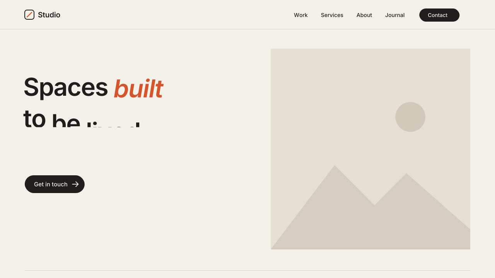

# 07 · Word-by-Word Headline Reveal

Headlines in a section rise word by word from behind a line mask as the
section scrolls into view. The kicker and body copy then fade up after the
headline. Italic or bold words can pick up the accent color.
Version **1.0.0** · Status: **beta: tested in real Chrome on a mock 7.1 page; not yet on a live site**



---

# Part 1 — Basic install

## Overview

- Works on the normal Squarespace **Text block**. The headline stays real text
  that you edit as usual. No images and no special fonts.
- Turn it on per section: only sections with the marker Code Block animate.
- Each section plays once, when it scrolls into view.
- Italic (`em`) or bold (`strong`) words in the headline get the accent color.
- Links, italics, bold and line breaks in the headline are kept.
- Screen readers hear the full headline once, not word by word.
- When the reveal ends, the headline goes back to the **exact** markup you
  typed. The same happens the moment you open the editor.
- Never runs inside the Squarespace editor.
- Visitors with "reduce motion" on see the text with no motion.

Requires the **Core plan or higher** (Code Injection).

## Step 1 — Installation

Settings → Developer Tools → Code Injection → **Footer**. Paste
[`snippets/footer-injection.html`](snippets/footer-injection.html).

Footer, not Header: the script reads the page content, so it must load after it.

## Step 2 — Mark the sections

In each section that should animate:

1. Add a **Code Block** anywhere in the section. Make it small; it shows nothing.
2. Paste [`snippets/code-block-marker.html`](snippets/code-block-marker.html):

   ```html
   <div data-swtl-words hidden></div>
   ```

3. Save.

The script animates **Heading 1 and Heading 2** in every Text block of that
section. Paragraphs and Heading 3/4 in the same Text blocks fade up after.

To color a word with the accent: select it in the Text block and press
**Italic** (or **Bold**).

## Step 3 — Test

- Open the published page in a private window (not the editor preview).
- The hero headline plays on load. Scroll down: each marked section plays
  when about 20% of its headline is on screen.
- Open the page in the editor → all text is normal and fully editable.

## Settings (optional)

Paste this **above** the snippet in the same Footer box:

```html
<script>
  window.SwtlWordReveal = {
    selector: 'h1, h2',   // which headings split into words
    stagger: 0.07,        // s between words (0.06–0.08 reads best)
    duration: 0.9,        // s for each word to rise
    fade: 'h3, h4, p',    // text that fades up after; '' = none
    accent: true,         // false = italic/bold words keep the text color
    threshold: 0.2        // how much of the heading shows before it plays
  };
</script>
```

One section different? Put the setting on its marker instead:

```html
<div data-swtl-words data-selector="h1" data-stagger="0.08" data-fade="" hidden></div>
```

---

# Part 2 — Styling

Colors come from the variables shared by every SWTL motion preset. Set them
once in **Design → Custom CSS**:

```css
:root {
  --swtl-accent: #D4552B;   /* italic / bold headline words */
  --swtl-wr-rise: 14px;     /* how far body copy rises as it fades in */
}
```

To follow the site's own accent color:

```css
:root { --swtl-accent: hsl(var(--accent-hsl)); }
```

Font, size and line height stay with the site styles. The mask is sized from
each word's font size, so any heading style works.

---

# Part 3 — For developers

| Item | Value |
|---|---|
| Namespace | `swtl-wr-` (classes, keyframes, CSS vars) · marker `data-swtl-words` · config `window.SwtlWordReveal` |
| Lifecycle | Footer script → finds markers → `section.page-section` → `.sqs-html-content` headings → split text nodes into `span.swtl-wr-w > span.swtl-wr-in` → IntersectionObserver (once) → keyframe rise → unwrap to stored `innerHTML` 80 ms after the last word lands |
| Split | Text nodes only; `em`, `strong`, `a`, `br` and their attributes stay. ASCII whitespace splits words; `&nbsp;` joins them. Masks are per word, so lines reflow on resize with no re-split |
| Mask | `clip-path: inset(-0.4em -0.25em -0.1em -0.25em)` on the outer span; inner span `translateY(105%)` → `none` |
| Timing | stagger 0.07s · 0.9s `cubic-bezier(.16,1,.3,1)` (expo out) · fades start 0.30s after the last word starts, 0.10s apart, 0.7s `cubic-bezier(.22,1,.36,1)` |
| Accessibility | heading gets `aria-label` with the original text (and each `a` keeps one); word spans are `aria-hidden`. Both removed on unwrap. Reduced motion: no split, no hidden state |
| Editor guard | exits when framed; MutationObserver on `body` class: `sqs-edit-mode-active` / `sqs-is-page-editing` → teardown restores byte-identical `innerHTML` and removes every class, attribute and inline style it added; class removed → re-init |
| Hidden state | only under `html.swtl-wr-on`, which the script adds. No script → visible text |
| Writes | `transform`, `opacity`, `animation-delay` on its own spans and on faded items. Never height, width or grid placement |
| Size | ~10.6 KB unminified (over the 8 KB budget: restore and a11y bookkeeping, link-underline fix, per-marker overrides) |
| Dependencies | none |

Why keyframes, not transitions: a transition needs a committed "before"
style. On first paint the browser can skip it and the text pops in. A keyframe
animation with `fill-mode: both` holds the hidden frame through its delay.

Files: `scene.py` (video; timing copied from the snippet CONFIG),
`checks.py` (9 timed frame checks), `browser.test.mjs` (28 real-Chrome checks).

---

# Part 4 — Support

## Troubleshooting

| Problem | Fix |
|---|---|
| Nothing animates | The section has no marker Code Block, or you are in the editor. Check the published page in a private window. |
| Only the hero animates | Each section needs its own marker. |
| Two words move as one | They are joined by a non-breaking space. Retype the space. |
| A word's descender looks cut off | Set a larger line height on the heading, or raise the last `inset` value in the snippet's `.swtl-wr-w` rule. |
| Link underline looks different during the reveal | The underline moves onto each word while it rises, then returns to the link. |
| I want all sections, no markers | Not supported on purpose. Per-section markers keep the effect deliberate. |

## Deployed on

— (not yet)
