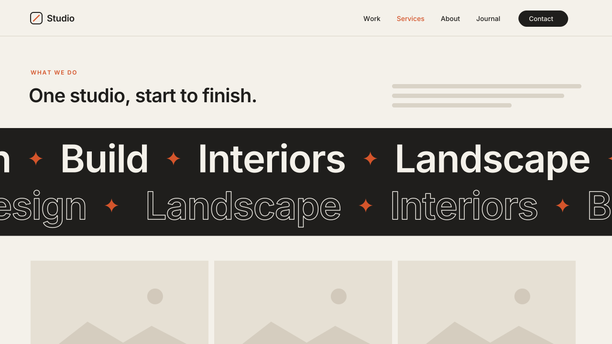

# 08 · Marquee Band

An endless ticker band of big words ("Design ✦ Build ✦ Interiors ✦ Landscape")
that scrolls across a section, with an optional second outlined band running
the other way. The words come from a normal Text Block, so the client edits
them like any other text.
Version **1.0.0** · Status: **beta: tested in real Chrome on a mock 7.1 page; not yet on a live site**



---

# Part 1 — Basic install

## Overview

- **Editable natively.** The phrases live in a Text Block. Change the text and
  the band follows. No code edits needed for copy changes.
- The same speed (pixels per second) on every screen size. A phone does not
  get a faster band than a desktop.
- The loop is seamless. There is no jump or gap at the wrap.
- Pauses on hover, when the band is off-screen, and when the browser tab is hidden.
- SEO-safe: the original Text Block stays in the page for search engines and
  screen readers. The moving copies are hidden from screen readers.
- Switches off fully while you edit. In the editor you see the plain Text
  Block, and you can move and resize it like any other block.
- Visitors with "reduce motion" on see a still band.

Requires the **Core plan or higher** (Code Injection).

## Step 1 — Installation

Settings → Developer Tools → Code Injection → **Footer**. Paste
[`snippets/footer-injection.html`](snippets/footer-injection.html). Do this once per site.

## Step 2 — Add the band to a section

1. In the section, add a **Text Block**. Type the phrases in one paragraph,
   separated by ` / `, e.g. `Design / Build / Interiors / Landscape`.
   One phrase per line (Shift + Enter) and ` — ` also work.
2. Stretch the Text Block to the full width of the grid. The band takes its place.
3. In the same section, add a **Code Block** and paste
   [`snippets/code-block-marker.html`](snippets/code-block-marker.html).
   The Code Block shows nothing on the live site.

**Which Text Block?** By default, the band uses the **first** Text Block in
the section. If the section also has a heading block above it, add
`data-source="2"` to the marker to use the second Text Block, and so on.

## Step 3 — Test

- Save and exit the editor. View the page while logged out, or in a private window.
- The band runs edge to edge. Hover over it and it stops.
- Open the editor. The band disappears and the Text Block shows as plain text.

## Settings (optional)

Each marker can carry its own settings:

| Attribute | Default | Values |
|---|---|---|
| `data-speed` | `100` | pixels per second |
| `data-direction` | `left` | `left` · `right` |
| `data-second-band` | off | `true` = add a second band running the other way |
| `data-style` | `solid` | `solid` · `outline` · `alternate` (every 2nd word outlined) |
| `data-second-style` | `outline` | style of the second band |
| `data-glyph` | `star` | `star` · `dot` · `none` |
| `data-pause-on-hover` | `true` | `false` to keep it moving |
| `data-bleed` | `true` | `false` = keep the band inside the content width |
| `data-source` | `1` | which Text Block in the section holds the phrases |

To change the defaults for the whole site, paste this **above** the Footer snippet:

```html
<script>
  window.SwtlMarquee = { speed: 80, secondBand: true, glyph: 'dot' };
</script>
```

---

# Part 2 — Styling

Colors come from the three variables that all SWTL motion presets share. Set
them once in **Design → Custom CSS**:

```css
:root {
  --swtl-paper: #F4F1EA;   /* words */
  --swtl-ink: #1F1E1C;     /* band background */
  --swtl-accent: #D4552B;  /* star / dot */
}
```

Marquee-only knobs (put them on `:root` or on one section's selector):

```css
:root {
  --swtl-mq-size: clamp(40px, 7vw, 96px); /* word size */
  --swtl-mq-bg: var(--swtl-ink);          /* band background */
  --swtl-mq-color: var(--swtl-paper);     /* word color */
  --swtl-mq-font: inherit;                /* e.g. var(--heading-font-font-family) */
  --swtl-mq-weight: 600;
  --swtl-mq-gap: .42em;                   /* space each side of a word */
  --swtl-mq-glyph: .42em;                 /* star size */
  --swtl-mq-stroke: 1.5px;                /* outline thickness */
  --swtl-mq-skew: 0deg;                   /* e.g. -8deg for a slanted band */
  --swtl-mq-pad: .22em;                   /* band padding, top and bottom */
}
```

To make one section different, target that section's ID:
`[data-section-id="…"] { --swtl-mq-bg: var(--swtl-accent); }`

---

# Part 3 — For developers

| Item | Value |
|---|---|
| Namespace | `swtl-mq-` (classes, keyframe, CSS variables) · marker `data-swtl-marquee` · config `window.SwtlMarquee` |
| Lifecycle | init on load → per marker: read Text Block → build `.swtl-mq-band` inside its `.sqs-block-content` → clip-hide `.sqs-html-content` → re-measure after `document.fonts.ready` |
| Loop math | one set width `w` is measured; copies are added until the track is ≥ 2× the viewport + 1 set; keyframe `0 → -w px`; `duration = w / speed`. State at 100% equals 0%. |
| Pausing | `IntersectionObserver` (off-screen) + `visibilitychange` (hidden tab) → `.swtl-mq-paused` (`animation-play-state`) · `:hover` when enabled |
| Resize | debounced 200 ms, rebuilds only when the width changes |
| Editor guard | exits when framed; `MutationObserver` on `body` class: `sqs-edit-mode-active` / `sqs-is-page-editing` → full teardown (band removed, every added class removed); leaving edit mode → re-init |
| Inline styles | only on the band (`width` and `margin-left` for the edge-to-edge bleed) and the track (CSS vars). Nothing is written on Squarespace elements. |
| Reduced motion | band is built with no animation (still) |
| Size | 9.5 KB unminified (over the 8 KB budget: six options plus Text Block parsing) |
| Dependencies | none |

Files: `snippets/` (paste-in), `scene.py` (video, same metrics as the CSS),
`checks.py` (9 timed frame checks, including frame(0) == frame(LOOP)),
`browser.test.mjs` (22 real-Chrome checks, including speed at 1280 and 390 px wide).

Video note: the preview runs at ~270 px/s so a full loop period fits in 5.9 s
(the snippet default is 100 px/s). The GIF is rendered with aliased edges to
stay under 2.5 MB. The MP4 and poster are antialiased.

---

# Part 4 — Support

## Troubleshooting

| Problem | Fix |
|---|---|
| No band, Text Block shows as normal | The marker Code Block is in a different section, or you are viewing inside the editor. Check while logged out. |
| Band shows the wrong text | It is reading another Text Block. Set `data-source="2"` (or 3…) on the marker. |
| All phrases run together as one | Separate them with ` / `, a line break, or ` — ` (spaces around the dash). |
| Small jump at the wrap | A web font loaded late. The script rebuilds on `document.fonts.ready`. If you load fonts some other way, resize the window once to confirm. |
| Band too fast or slow on mobile | Speed is in px/s on purpose. Lower `data-speed` for every screen. |
| Band leaves a gap at the sides | Set `data-bleed="true"` (default), or the section has its own side padding. That padding is fine, because the band measures it. |

## Deployed on

— (not yet)
