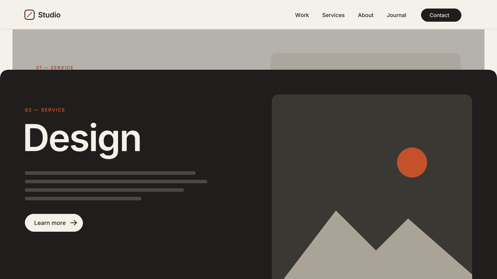

# 09 · Sticky Stacked-Card Scroll

Consecutive page sections become a stack of cards. As the visitor scrolls,
each section pins under the header and the next one slides up over it with
rounded top corners. The covered card shrinks slightly and dims.
Version **1.0.0** · Status: **beta: tested in real Chrome on a mock 7.1 page; not yet on a live site**



---

# Part 1 — Basic install

## Overview

- Works on the **existing sections**. You build them as normal in Fluid Engine.
- Uses `position: sticky` only. Section heights stay what the editor gives
  them. Nothing is locked to a height, so every section stays resizable.
- Reads the height of a fixed header and pins the cards below it.
- Off below 768px wide by default. On phones the sections scroll normally.
- Turns itself off in the Squarespace editor. All of its classes and styles
  come off, and they go back on when you leave the editor.
- Visitors with "reduce motion" on still get the stacking, but no shrink and
  no dim.

Requires the **Core plan or higher** (Code Injection).

## Step 1 — Installation

Settings → Developer Tools → Code Injection → **Footer**. Paste
[`snippets/footer-injection.html`](snippets/footer-injection.html).

## Step 2 — Mark the stack

1. Build the sections that will stack, one after the other. Three is a good
   number. Give each one a different background color so the cards read.
2. In the **first** section of the stack, add a Code Block and paste
   [`snippets/code-block-marker.html`](snippets/code-block-marker.html).
   Make the block small and move it into a corner. It shows nothing on
   the live site.
3. Set `data-count` to the number of sections in the stack, counting the
   first one. `data-count="3"` = this section plus the next two.

Sections outside the count are not changed. You can put more than one stack
on a page. Give each one its own marker.

**Height tip:** this effect looks best when each card section is about one
screen tall (Section → Format → Height → Large or Custom). A section taller
than the screen still works. It pins by its bottom edge, so all of its
content can be read before the next card covers it.

## Step 3 — Test

- Open the published page **logged out** (or in a private window) and scroll.
  In the editor the effect is off on purpose.
- Make the browser narrow (under 768px). The sections must scroll normally.

## If the cards do not pin

Sticky stops working when a wrapper around the sections has
`overflow: hidden`. The script finds those wrappers and changes them to
`overflow-x: clip`, which also stops sideways scroll but lets sticky work. If a
template or plugin sets the overflow again after the page loads, add this
in **Design → Custom CSS**:

```css
html, body, #siteWrapper, #page, .sections {
  overflow-x: clip !important;
  overflow-y: visible !important;
}
```

## Settings (optional)

Paste this **above** the snippet in the same Footer box:

```html
<script>
  window.SwtlStack = {
    headerOffset: 'auto',   // 'auto' = fixed header height, or a px number (0 = top of screen)
    scale: 0.94,            // covered card shrinks to this
    dim: 0.35,              // how dark the covered card gets (0 = no dim)
    radius: 24,             // px, top corners of each incoming card
    mobileBreakpoint: 768,  // below this width ...
    disableOnMobile: true   // ... the sections scroll normally
  };
</script>
```

To change one stack only, put the setting on its marker:
`<div data-swtl-stack data-count="4" data-scale="0.9" data-dim="0.5" data-radius="32" hidden></div>`

---

# Part 2 — Styling

Colors come from the CSS variables shared by every SWTL motion preset. Set
them once in **Design → Custom CSS**:

```css
:root {
  --swtl-ink: #1F1E1C;               /* dim color (default) */
  --swtl-sk-shade-color: #000;       /* optional: dim with a different color */
}
```

The card colors are the sections' own backgrounds. Set them in each
section's Background panel (or a color theme), as usual.

Corner radius and shrink are settings (above), not CSS, because the script
sets them per stack.

---

# Part 3 — For developers

| Item | Value |
|---|---|
| Namespace | `swtl-sk-` classes · `--swtl-sk-top / -shade / -radius / -shade-color` · `data-swtl-stack` · `window.SwtlStack` |
| Classes added | `swtl-sk-card` (sticky, cards 1…n-1) · `swtl-sk-round` (clip-path top radius, cards 2…n) · `swtl-sk-after` (`position: relative` on card n + following sections so they paint above) · `swtl-sk-unclip` (ancestors with overflow hidden/auto/scroll) |
| Inline writes | `transform: scale()` and `--swtl-sk-shade` (from rAF only), `--swtl-sk-top`, `--swtl-sk-radius`. Never height/min-height/width/grid. |
| Progress | covered card i: `p = clamp((innerHeight − next.top) / (innerHeight − stickyTop))` · scale `1 − (1 − scale)·p` · dim `dim·p` · origin top-center |
| Sticky top | `min(headerOffset, innerHeight − section.offsetHeight)`. Tall sections pin by their bottom edge. `headerOffset:'auto'` = bottom of `#header` when it is fixed/sticky, else 0. |
| Scroll loop | passive `scroll` → one rAF → read pass (`getBoundingClientRect`) → write pass (transform + custom property only) |
| Lifecycle | `DOMContentLoaded` → sync. A MutationObserver on `body` class tears down on `sqs-edit-mode-active` / `sqs-is-page-editing` and re-inits on exit. `resize` re-checks the breakpoint and re-measures. Reduced motion `change` re-inits. |
| Guards | exits when framed (`self !== top`) · reduced motion: sticky kept, no scale/dim |
| Overflow | Walks the ancestors of the first card. Any with `overflow` hidden/auto/scroll gets `overflow-x: clip; overflow-y: visible`. Body is skipped when its overflow passes to the viewport. |
| Size | ~7.9 KB unminified |
| Dependencies | none (no GSAP) |

Files: `scene.py` (video, same math as the script), `checks.py` (8 timed
frame checks), `browser.test.mjs` (22 real-Chrome checks on a
`#siteWrapper > main#page > article.sections > section.page-section` page
with a fixed header and an `overflow-x: hidden` wrapper).

---

# Part 4 — Support

## Troubleshooting

| Problem | Fix |
|---|---|
| Cards scroll away and do not pin | A wrapper has `overflow: hidden` that is set again after load. Add the Custom CSS from "If the cards do not pin". |
| Cards pin behind the header | The header is not `#header` or not fixed. Set `headerOffset` to its height in px. |
| Nothing happens | You are in the editor, the window is under 768px, or the marker is not in the first section. Test logged out. |
| A dark shade sits over the wrong section | Two markers overlap. Each stack needs its own sections. |
| Sections after the stack look shifted | They get `position: relative` only. Check custom CSS that sets `position` on `.page-section`. |

## Deployed on

— (not yet)
