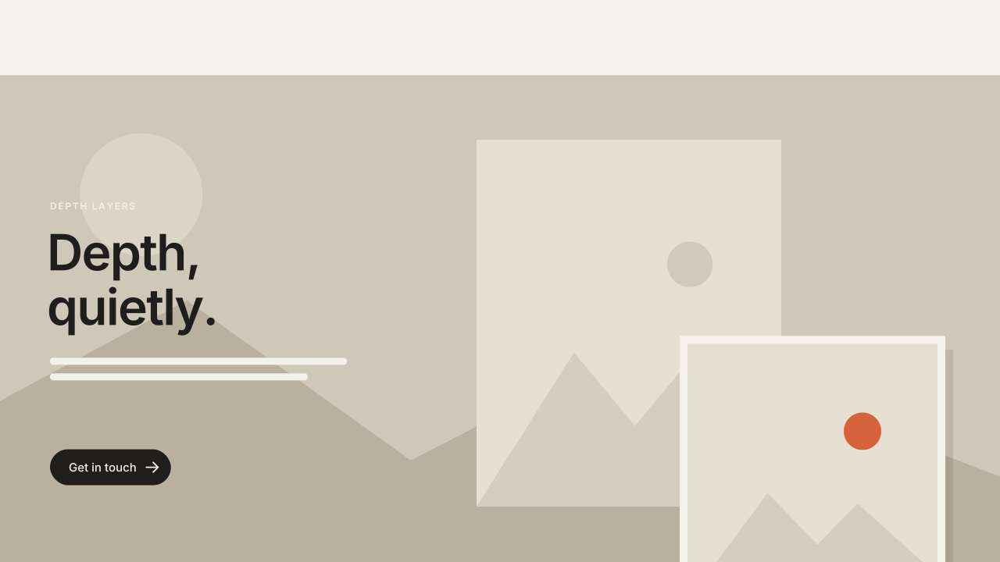

# 10 · Parallax Depth Layers

Blocks inside a marked section scroll at slightly different speeds, so the
section reads as layers: photos sink back, text stays put, buttons and accent
images float forward. The section background can drift too.
Version **1.0.0** · Status: **beta: tested in real Chrome on a mock 7.1 page; not yet on a live site**



---

# Part 1 — Basic install

## Overview

- Works per section. Only sections with the marker Code Block move.
- Defaults by block type: **image blocks** drift slower, **text blocks** do not
  move, **button blocks** drift a little faster.
- Every block is at its exact editor position when the section is centered on
  screen, and never moves more than **80px** from it. The layout you build in
  the editor is the layout visitors see.
- No block is resized. Only `transform` is animated.
- Only runs while the section is near the screen, and sleeps when scrolling stops.
- Off on phones (below 768px), inside the Squarespace editor, and for visitors
  with "reduce motion" on.

Requires the **Core plan or higher** (Code Injection).

## Step 1 — Installation

Settings → Developer Tools → Code Injection → **Footer**. Paste
[`snippets/footer-injection.html`](snippets/footer-injection.html).

This is a one-time, sitewide install. It does nothing until a section has the marker.

## Step 2 — Mark a section

1. Edit the page, add a **Code Block** anywhere in the section.
2. Paste [`snippets/code-block-marker.html`](snippets/code-block-marker.html).
3. Make the Code Block small and put it in a corner. The marker is hidden, so
   the block shows nothing on the live site.

To use the defaults, the marker can be as short as:

```html
<div data-swtl-parallax hidden></div>
```

## Step 3 — Tune per section (optional)

Each attribute on the marker changes one setting for that section only.

| Attribute | Default | What it does |
|---|---|---|
| `data-images` | `-0.15` | Image block speed. Negative = slower than the page. |
| `data-text` | `0` | Text block speed. |
| `data-buttons` | `0.08` | Button block speed. Positive = faster than the page. |
| `data-other` | `0` | Every other block type. |
| `data-background` | `-0.2` | Section background image. `0` turns it off. |
| `data-max` | `80` | Largest distance in px any block can move. |
| `data-blocks` | — | Per-block override, e.g. `"2:-0.2,5:0.1"`. |

**Per-block override.** Count the blocks in the section top to bottom, then
left to right on the same row; the first is `1`. The marker Code Block is not
counted. `data-blocks="2:-0.25,4:0.12"` makes block 2 sink further back and
block 4 float forward. Use `N:0` to pin one block.

Good starting points: `-0.1` to `-0.25` for photos, `0.05` to `0.15` for a
small accent image or badge. Keep it subtle.

## Step 4 — Test

- Open the live page (logged out or in a private window) and scroll past the section.
- Inside the editor nothing moves. That is intended.

## Settings (optional)

Paste this **above** the snippet in the same Footer box to change the sitewide
defaults (the marker still wins per section):

```html
<script>
  window.SwtlParallax = {
    images: -0.15,
    text: 0,
    buttons: 0.08,
    other: 0,
    background: -0.2, // 0 = never move section backgrounds
    bgScale: 1.12,    // background oversize, so its edges never show
    max: 80,          // px
    minWidth: 768,    // px; 0 = also run on phones
    margin: 200       // px; start updating this far before the section enters
  };
</script>
```

---

# Part 2 — Styling

The effect has no colors of its own. It moves what you built in the editor.

Design tips:

- Overlap two image blocks in Fluid Engine (one large, one small on top) and
  give them different speeds. That is where the depth reads best.
- Give the front image a border or a shadow in **Design → Custom CSS** so it
  looks like it sits above:

```css
.swtl-px-layer.image-block img {
  box-shadow: 0 18px 40px rgba(31, 30, 28, 0.12);
}
```

- Leave about 80px of space above and below a moving block if it is next to
  the section edge, or it can slide under the next section.
- A background image moves inside its section and is shown at 112% size. Pick
  an image without important detail at the very edges.

---

# Part 3 — For developers

| Item | Value |
|---|---|
| Namespace | `swtl-px-` (classes `swtl-px-on` on `<html>`, `swtl-px-layer`, `swtl-px-bg`, `swtl-px-bgimg`) · marker `data-swtl-parallax` · config `window.SwtlParallax` |
| Formula | `dist = section centre − viewport centre` · `y = clamp(speed × dist, ±max)` · `transform: translate3d(0, y, 0)` on `.sqs-block` |
| Background | `.section-background img`: `translate3d(0, clamp(speed × dist, ±h × (scale−1)/2), 0) scale(1.12)`; wrapper gets `overflow: hidden` |
| Visual order | `.fluid-engine > .fe-block` sorted by measured top, then left, before any transform |
| Loop | IntersectionObserver (`rootMargin: 200px`) gates a rAF loop; rAF also sleeps after 20 frames without a change, and wakes on `scroll` |
| Editor guard | exits when framed; MutationObserver on `body` class: `sqs-edit-mode-active` / `sqs-is-page-editing` → teardown (removes every class and inline transform it set), re-init on exit |
| Responsive | below `minWidth` or with reduced motion → teardown; re-checked on resize (150ms debounce) and on reduced-motion change |
| Size | ~8.0 KB Footer + 0.6 KB marker |
| Dependencies | none |

Files: `snippets/footer-injection.html`, `snippets/code-block-marker.html`,
`scene.py` (video, same formula and default speeds), `checks.py` (8 timed
frame checks), `browser.test.mjs` (27 real-Chrome checks: scroll response,
clamp, per-block override, rAF stop offscreen and when idle, unchanged block
sizes, mobile, edit-mode teardown, iframe guard, reduced motion).

---

# Part 4 — Support

## Troubleshooting

| Problem | Fix |
|---|---|
| Nothing moves | You are in the editor or a phone-width window, or "reduce motion" is on. Check logged out at desktop width. |
| The wrong block moves with `data-blocks` | Count top to bottom, then left to right, and skip the marker Code Block. Blocks on the same row count left first. |
| A block slides under the next section | Lower `data-max` or that block's speed, or add space at the section edge. |
| Background edge shows | Raise `bgScale` (e.g. `1.18`) or lower `data-background`. |
| It feels seasick | Halve the speeds. Most sites look best between `-0.15` and `0.1`. |

## Deployed on

— (not yet)
