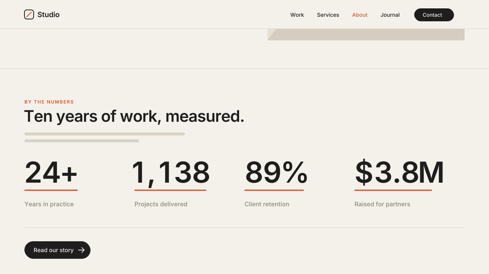

# 11 · Stat Count-Up

Numbers you type in Text blocks count up from 0 when they scroll into view.
They end on the exact text you typed. A thin accent line grows under each one.
Version **1.0.0** · Status: **beta: tested in real Chrome on a mock 7.1 page; not yet on a live site**



---

# Part 1 — Basic install

## Overview

- Type your numbers as normal text in Text blocks: `25+`, `1,200`, `98%`,
  `$4.5M`, `3.2x`. No special markup.
- By default only **headings** (Heading 1–4) count. Labels and body copy in
  paragraphs are left alone.
- Prefixes, suffixes, commas and decimals stay as you typed them. `$4.5M`
  counts `$0.0M → $4.5M`.
- Years (1900–2099) and words like `24/7` or `COVID-19` are skipped.
- Numbers that come into view together start one after another, left to
  right.
- Nothing moves sideways. The typed number holds its space while a copy
  counts over it.
- Screen readers always read the real number, never the count.
- Plays once per page view.
- Never runs inside the Squarespace editor. If you open the editor on a live
  page, it puts your text back exactly as it was.
- Visitors with "reduce motion" on see the final numbers, with no count.
- If the script fails or is blocked, the numbers show as typed.

Requires the **Core plan or higher** (Code Injection).

## Step 1 — Installation

Settings → Developer Tools → Code Injection → **Footer**. Paste
[`snippets/footer-injection.html`](snippets/footer-injection.html).

## Step 2 — Mark the section

In the section that holds your numbers, add a **Code Block** and paste
[`snippets/code-block-marker.html`](snippets/code-block-marker.html):

```html
<div data-swtl-countup hidden></div>
```

The block shows nothing on the live site. Make it small and put it in a
corner of the section.

Set each number as **Heading 1–4**. Put its label under it as a paragraph.

## Step 3 — Test

- Open the page in a private window and scroll to the section → the numbers
  count up and the lines grow.
- When the count stops, each number reads exactly as you typed it.
- Open the editor → the numbers show as typed and can be edited.

## Settings (optional)

Paste this **above** the snippet in the same Footer box:

```html
<script>
  window.SwtlCountUp = {
    target: 'headings',   // 'headings' | 'emphasis' | 'all'
    duration: 1.6,        // s per number
    stagger: 0.12,        // s between numbers
    maxDelay: 0.8,        // s cap on the stagger
    underline: true,      // accent line under each number
    skipYears: true       // leave 1900–2099 alone
  };
</script>
```

| `target` | Which numbers count |
|---|---|
| `headings` (default) | Numbers in Heading 1–4 |
| `emphasis` | Only numbers you make **bold** or *italic* (any text style) |
| `all` | Headings and paragraphs |

`emphasis` is the most precise choice when a heading mixes words and
numbers. Bold only the number you want to count.

To change one section only, put the values on its marker:

```html
<div data-swtl-countup data-target="emphasis" data-underline="false" hidden></div>
```

---

# Part 2 — Styling

| Variable | Default | What it does |
|---|---|---|
| `--swtl-cu-line-color` | `var(--swtl-accent, #D4552B)` | Line color |
| `--swtl-cu-line-size` | `max(2px, 0.045em)` | Line thickness |
| `--swtl-cu-line-gap` | `-0.06em` | Line position (more negative = lower) |

Set them in Custom CSS:

```css
:root { --swtl-cu-line-color: #1F1E1C; --swtl-cu-line-size: 3px; }
```

Numbers with a fixed digit count (`98%`, `4.5`) look calmest. Big counts
(`1,200`) grow from the right, like a scoreboard.

---

# Part 3 — For developers

| Item | Value |
|---|---|
| Namespace | `swtl-cu-` (classes, CSS variables) · marker `data-swtl-countup` · config `window.SwtlCountUp` |
| Parsing | each whitespace-separated word must match `^[symbol]{0,2} number [.decimals] [non-digit]{0,4}$`, with one number only. Commas kept when typed; decimal places kept |
| DOM | the text node is split into text + `span.swtl-cu-stat` > prefix, `span.swtl-cu-box` (> `span.swtl-cu-final` real text, opacity 0 · `span.swtl-cu-run` aria-hidden, absolute, right-aligned, tabular-nums), suffix |
| Lifecycle | DOMContentLoaded → wrap → `html.swtl-cu-on` → IntersectionObserver (`rootMargin 0 0 -10% 0`, once) → rAF count → overlay removed. Underline off: original text node put back. Underline on: `span.swtl-cu-stat.swtl-cu-done` with plain text stays |
| Timing | 1.6s · ease-out cubic `1-(1-p)^3` · stagger 0.12s per batch, cap 0.8s |
| Animates | text of the aria-hidden copy, and `transform: scaleX()` on the line pseudo-element. Never writes height, width or grid placement |
| Editor guard | exits when framed; MutationObserver on `body` class: `sqs-edit-mode-active` / `sqs-is-page-editing` → original text nodes put back (byte-identical innerHTML), removal → re-init |
| Size | ~9.7 KB unminified (over the 8 KB budget: parser + exact restore) |
| Dependencies | none |

Files: `snippets/footer-injection.html`, `snippets/code-block-marker.html`,
`scene.py` (video; simulates the observer with the snippet's values),
`checks.py` (7 timed frame checks), `browser.test.mjs` (25 real-Chrome
checks: all five formats count from 0 to the exact text, no layout shift,
byte-identical restore, editor, frame, reduced motion).

---

# Part 4 — Support

## Troubleshooting

| Problem | Fix |
|---|---|
| Nothing counts | No marker in the section, the number is in a paragraph (use a heading or `target: 'all'`), or you are inside the editor frame. Use a private window. |
| A year counts up | Set `skipYears: true` (default), or keep the year out of headings. |
| A number in a sentence counts and should not | Use `target: 'emphasis'` and bold only the stats. |
| `1.5k` or `10M+` does not count | Suffixes up to 4 characters work. Check there is no space between the number and its suffix. |
| Digits nudge 1–2px when the count ends | Normal: the count uses even-width digits, the typed text does not. |
| Line is the wrong color | Set `--swtl-cu-line-color`, or `underline: false`. |

## Deployed on

— (not yet)
