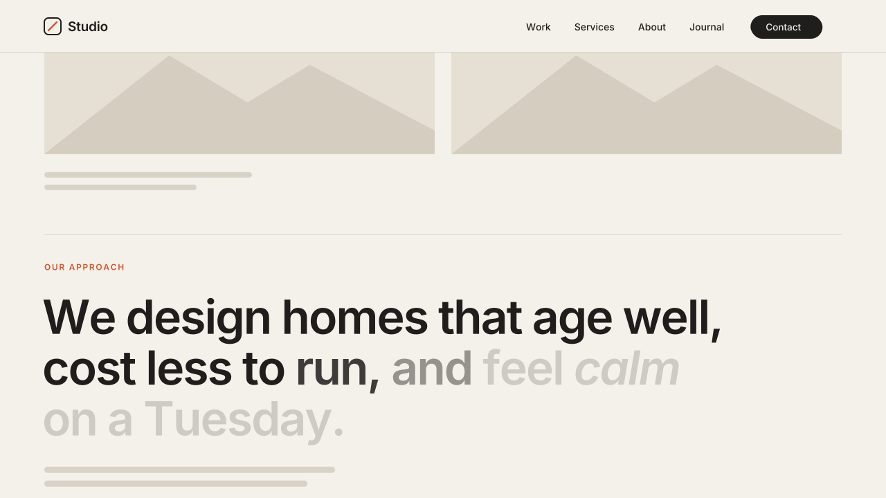

# 12 · Scroll Text Fill

A large statement starts muted. As you scroll, its words fill to full ink one
by one, in reading order. Italic or bold words fill to the accent color.
Scroll back up and the words go muted again.
Version **1.0.0** · Status: **beta: tested in real Chrome on a mock 7.1 page; not yet on a live site**



---

# Part 1 — Basic install

## Overview

- Works on the normal Squarespace **Text block**. The statement stays real
  text that you edit as usual. No images and no special fonts.
- Turn it on per section: only sections with the marker Code Block fill.
- The fill follows the scroll position, not a timer. It starts when the top
  of the text reaches 85% down the screen and is complete at 40%.
- Italic (`em`) or bold (`strong`) words fill to the accent color.
- Links, italics, bold and line breaks are kept. The text wraps normally on
  every screen size.
- Screen readers hear each heading once, as one sentence.
- The moment you open the editor, the text goes back to the **exact**
  markup you typed.
- Never runs inside the Squarespace editor.
- Visitors with "reduce motion" on see the text fully filled, with no motion.

Requires the **Core plan or higher** (Code Injection).

## Step 1 — Installation

Settings → Developer Tools → Code Injection → **Footer**. Paste
[`snippets/footer-injection.html`](snippets/footer-injection.html).

Footer, not Header: the script reads the page content, so it must load after it.

## Step 2 — Mark the sections

In each section that should fill:

1. Add a **Code Block** anywhere in the section. Make it small; it shows nothing.
2. Paste [`snippets/code-block-marker.html`](snippets/code-block-marker.html):

   ```html
   <div data-swtl-fill hidden></div>
   ```

3. Save.

The script fills **all headings and paragraphs** in every Text block of that
section. For a single statement, use one Text block with one large heading
or a large paragraph. To fill only the headings, see Settings.

To color a word with the accent: select it in the Text block and press
**Italic** (or **Bold**).

## Step 3 — Test

- Open the published page in a private window (not the editor preview).
- Scroll slowly past the section. The words fill as the text moves up the
  screen. Scroll back up: they go muted again.
- Open the page in the editor → all text is normal and fully editable.

## Settings (optional)

Paste this **above** the snippet in the same Footer box:

```html
<script>
  window.SwtlTextFill = {
    selector: 'h1, h2, h3, h4, p',  // which text fills
    start: 0.85,   // fill starts when the text top is 85% down the screen
    end: 0.40,     // fill is complete when the text top is 40% down
    soft: 2,       // words in the soft edge (1 = crisp, 4 = smooth)
    dim: null,     // muted opacity; null = use --swtl-tf-dim (0.18)
    accent: true   // false = italic/bold words fill to the text color
  };
</script>
```

A long statement fills too fast? Lower `end` (for example `0.25`) so the
fill runs over more scroll.

One section different? Put the setting on its marker instead:

```html
<div data-swtl-fill data-selector="h2" data-start="0.9" data-end="0.3" data-dim="0.25" hidden></div>
```

---

# Part 2 — Styling

Colors come from the variables shared by every SWTL motion preset. Set them
once in **Design → Custom CSS**:

```css
:root {
  --swtl-accent: #D4552B;   /* italic / bold words when filled */
  --swtl-tf-dim: 0.18;      /* opacity of words not yet filled */
}
```

To follow the site's own accent color:

```css
:root { --swtl-accent: hsl(var(--accent-hsl)); }
```

On a dark section, a slightly higher dim (0.25–0.3) reads better.

Font, size, color and line height stay with the site styles. The filled
state is the text's own color.

---

# Part 3 — For developers

| Item | Value |
|---|---|
| Namespace | `swtl-tf-` (classes, CSS vars) · marker `data-swtl-fill` · config `window.SwtlTextFill` |
| Lifecycle | Footer script → finds markers → `section.page-section` → `.sqs-html-content` elements matching `selector` (outermost match only) → split text nodes into inline `span.swtl-tf-w` → IntersectionObserver toggles a rAF loop → per frame, progress from `getBoundingClientRect().top` |
| Progress | `p = (start·vh − top) / ((start − end)·vh)`, clamped 0..1. Word *i* of *n*: `f = clamp((p·(n + soft) − i) / soft)`, written as `--swtl-tf-f` only when it changes |
| Fill | `opacity: dim + (1 − dim)·f`. Accent words: `color: color-mix(in srgb, var(--swtl-accent) f·100%, currentColor)`. No color-mix → accent at the dim opacity |
| Split | Text nodes only; `em`, `strong`, `a`, `br` and their attributes stay. ASCII whitespace splits words; `&nbsp;` joins them. Spans stay `display: inline`, so lines reflow on resize with no re-split |
| Performance | rAF runs only while at least one filled element intersects the viewport. On exit, one last update settles it at 0 or 1 |
| Accessibility | headings get `aria-label` with the original text (each `a` inside keeps one) and the word spans are `aria-hidden`. Paragraph words stay exposed (`aria-label` is not allowed on `<p>`). Reduced motion: no split, no dim, accent class on `em`/`strong` |
| Editor guard | exits when framed; MutationObserver on `body` class: `sqs-edit-mode-active` / `sqs-is-page-editing` → teardown restores byte-identical `innerHTML`, the original `class` and `aria-label` attributes; class removed → re-init at the current scroll position |
| Dim state | only under `html.swtl-tf-on`, which the script adds. No script → full-ink text |
| Writes | `--swtl-tf-f` (and optional `--swtl-tf-dim`) on its own spans. Never height, width or grid placement on Squarespace elements |
| Size | ~8.9 KB unminified (over the 8 KB budget: restore and a11y bookkeeping, per-marker overrides) |
| Dependencies | none |

Files: `scene.py` (video; the scroll drives the fill with the snippet's
formula and CONFIG values), `checks.py` (7 timed frame checks),
`browser.test.mjs` (34 real-Chrome checks).

---

# Part 4 — Support

## Troubleshooting

| Problem | Fix |
|---|---|
| Nothing fills | The section has no marker Code Block, or you are in the editor. Check the published page in a private window. |
| The text is already full when I reach it | It sits high on the page, so its top starts above the 40% line. Raise `start`/`end` on that marker (for example `data-start="0.95" data-end="0.6"`). |
| The kicker or body copy fills too | Limit the marker to the statement: `data-selector="h2"`. |
| Two words fill as one | They are joined by a non-breaking space. Retype the space. |
| The link underline looks strong while words are muted | The underline under spaces is not dimmed. Avoid links inside the statement, or accept it. |
| Accent word stays muted orange in an old browser | That browser has no `color-mix()`. The word still fills in opacity. |

## Deployed on

— (not yet)
