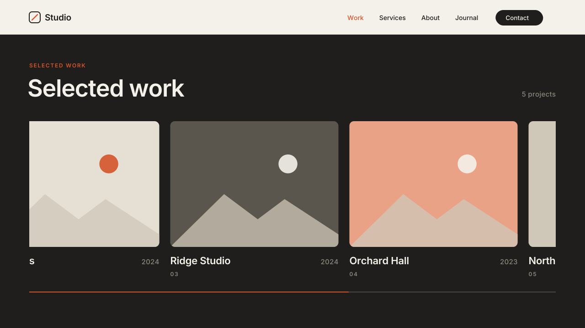

# 13 · Horizontal Scroll Gallery

The page scrolls down into a row of cards. The section pins under the
header, and as the visitor keeps scrolling, the cards slide left. An accent
hairline under the cards shows how far along they are. At the last card the
section unpins and the page scrolls on as normal.
Version **1.0.0** · Status: **beta: tested in real Chrome on a mock 7.1 page; not yet on a live site**



---

# Part 1 — Basic install

## Overview

- The cards are a native **List Section** in the **Carousel** layout. You add,
  remove and reorder cards in the List panel (image, title, description,
  button), as usual.
- 1px of scroll moves the cards 1px. The scroll room comes from an empty,
  invisible spacer the script adds to the end of the section. No Squarespace
  element gets a height, so every section stays resizable.
- Reads the height of a fixed header and pins the section below it.
- Below 768px wide there is no pin. The cards become a swipe row that snaps
  to each card.
- Turns itself off in the Squarespace editor. The spacer, the hairline and
  all classes come off, and the section shows exactly as the editor laid it
  out. They come back when you leave the editor.
- Visitors with "reduce motion" on get the swipe row, not the pin.

Requires the **Core plan or higher** (Code Injection).

### Why a List Section (and not Fluid Engine or a Gallery)

| Source | Result |
|---|---|
| **List Section, Carousel** (used) | Each card is one list item: image + title + description, edited in one panel. The carousel already lays the cards out in one row that runs past the edge. The script only moves that row. |
| Fluid Engine section | The grid is always as wide as the screen. A row of cards wider than the screen needs a fixed width on Squarespace elements, which breaks editing. |
| Gallery Section | Images only. Titles and years would need captions, and the gallery runs its own layout and lazy-load scripts that fight a moving row. |

## Step 1 — Installation

Settings → Developer Tools → Code Injection → **Footer**. Paste
[`snippets/footer-injection.html`](snippets/footer-injection.html).

## Step 2 — Build the cards

1. Add a section → **List** → choose a **Carousel** layout.
2. Add one item per project. Image, title (project name) and description
   (the year) make the card in the preview.
3. In the List design panel, set **Max columns** to 3 (or 2 for big cards).
   This sets the card width. More items than columns = more travel.
4. Give the section a dark background or a color theme, so the hairline reads.

## Step 3 — Mark the gallery

A List Section has no blocks, so the marker goes in the section **above** it:

1. In the section directly above the List Section, add a **Code Block** and
   paste [`snippets/code-block-marker.html`](snippets/code-block-marker.html).
   Make the block small and move it into a corner. It shows nothing on the
   live site.
2. The script finds the next carousel List Section below the marker.

To point at one section anywhere on the page, give the marker its section id:
`<div data-swtl-hscroll data-section="6543abc…" hidden></div>` (the
`data-section-id` of the List Section, from the browser's inspector).

**Height tip:** the section pins from the top. It looks best when the title +
cards fit in one screen below the header. A taller section pins by its bottom
edge, so the cards stay in view.

## Step 4 — Test

- Open the published page **logged out** (or in a private window) and scroll.
  In the editor the effect is off on purpose.
- Make the browser narrow (under 768px). The cards must swipe and snap, and
  the page must not pin.

## If the section does not pin

Sticky stops working when a wrapper around the section has
`overflow: hidden`. The script finds those wrappers and changes them to
`overflow-x: clip`, which also stops sideways scroll but lets sticky work. If a
template or plugin sets the overflow again after the page loads, add this in
**Design → Custom CSS**:

```css
html, body, #siteWrapper, #page, .sections, .page-section {
  overflow-x: clip !important;
  overflow-y: visible !important;
}
```

## Settings (optional)

Paste this **above** the snippet in the same Footer box:

```html
<script>
  window.SwtlHScroll = {
    headerOffset: 'auto',   // 'auto' = fixed header height, or a px number (0 = top of screen)
    mobileBreakpoint: 768,  // below this width: swipe row, no pin
    progressBar: true,      // accent hairline under the cards
    barGap: 32              // px from the cards to the hairline
  };
</script>
```

---

# Part 2 — Styling

Colors come from the CSS variables shared by every SWTL motion preset. Set
them once in **Design → Custom CSS**:

```css
:root {
  --swtl-accent: #D4552B;                 /* hairline fill */
  --swtl-hs-bar-bg: rgba(255,255,255,.2); /* hairline track (default: muted gray) */
  --swtl-hs-bar-h: 2px;                   /* hairline thickness */
}
```

Card size, spacing, image ratio and text styles are the List Section's own
design settings. The script does not change them.

The carousel's arrow buttons are hidden while the effect runs, because the
scroll moves the cards. In the editor they show again.

---

# Part 3 — For developers

| Item | Value |
|---|---|
| Namespace | `swtl-hs-` classes · `--swtl-hs-top / -x / -p / -bar-bg / -bar-h` · `data-swtl-hscroll` · `window.SwtlHScroll` |
| Source DOM | `section.page-section` → `.content-wrapper` → … `.user-items-list-carousel__slideshow-holder` (clips) → `ul.user-items-list-carousel__slides` (the track) |
| Scroll room | One `div.swtl-hs-spacer[aria-hidden]` appended as the **last child of the section**. Its height = `track.scrollWidth − holder.clientWidth`. The section gets `flex-wrap: wrap` (7.1 sections are flex) and the spacer `flex: 0 0 100%`, so it always sits under the content. Removed on teardown. |
| Pin | `.content-wrapper` gets `swtl-hs-stick` (`position: sticky; top: --swtl-hs-top`). The section is its containing block, so it pins for exactly the spacer height and then unpins on its own. Top = `min(headerOffset, innerHeight − cw.offsetHeight)`. |
| Track | `p = clamp((stickyTop + cwH − spacer.top) / dist)` · `--swtl-hs-x = −dist·p` · class rule `transform: translate3d(var(--swtl-hs-x),0,0) !important` beats the carousel's inline transform. |
| Hairline | `div.swtl-hs-bar[aria-hidden] > i` inside the content-wrapper, placed under the holder from measured rects (`left/width/top` on the script's own element). Fill = `scaleX(--swtl-hs-p)`. |
| Inline writes | On Squarespace elements: custom properties only (`--swtl-hs-top`, `--swtl-hs-x`). Height only on the script's own spacer. Never height/min-height/width/grid on Squarespace elements. |
| Scroll loop | passive `scroll` → one rAF, only while an IntersectionObserver reports a gallery section on screen → read pass (`getBoundingClientRect` of the spacer) → write pass (custom properties only). A ResizeObserver on the track re-measures when late images change the width. |
| Mobile / reduced motion | `swtl-hs-swipe` on the holder: `overflow-x: auto; scroll-snap-type: x mandatory`; items `scroll-snap-align: start`; track `transform: none !important`. No spacer, no pin, no rAF. |
| Lifecycle | `DOMContentLoaded` → sync (`off` / `pin` / `swipe`). MutationObserver on `body` class tears down on `sqs-edit-mode-active` / `sqs-is-page-editing` and re-inits on exit. `resize` switches mode at the breakpoint or re-measures. Reduced motion `change` re-syncs. |
| Guards | exits when framed (`self !== top`) |
| Overflow | Walks the ancestors of the content-wrapper (section included). Any with overflow hidden/auto/scroll gets `overflow-x: clip; overflow-y: visible`. Body is skipped when its overflow passes to the viewport. |
| Size | ~9.0 KB unminified (over the 8 KB budget: two modes, spacer, hairline, observers) |
| Dependencies | none (no GSAP) |

Files: `scene.py` (video, same math as the script), `checks.py` (8 timed
frame checks), `browser.test.mjs` (30 real-Chrome checks on a
`#siteWrapper > main#page > article.sections > section.page-section` page
with a fixed header, flex sections, `overflow: hidden` wrappers and a
carousel track that carries its own inline transform).

---

# Part 4 — Support

## Troubleshooting

| Problem | Fix |
|---|---|
| Nothing happens | You are in the editor, the window is under 768px, or there is no carousel List Section below the marker. Check the List layout is a **Carousel** one. Test logged out. |
| The section scrolls away and does not pin | A wrapper has `overflow: hidden` that is set again after load. Add the Custom CSS from "If the section does not pin". |
| It pins behind the header | The header is not `#header` or not fixed. Set `headerOffset` to its height in px. |
| The cards do not move far enough / too far | The travel is measured from the card row. If images load very late on a slow connection, resize the window once; a ResizeObserver also re-measures. |
| Big empty space under the section in the editor | It should not happen: the spacer comes off in the editor. If you see it, the editor body classes changed. Report it with the page URL. |
| The arrow buttons are gone | On purpose while the effect runs. They show again in the editor. |

## Deployed on

— (not yet)
