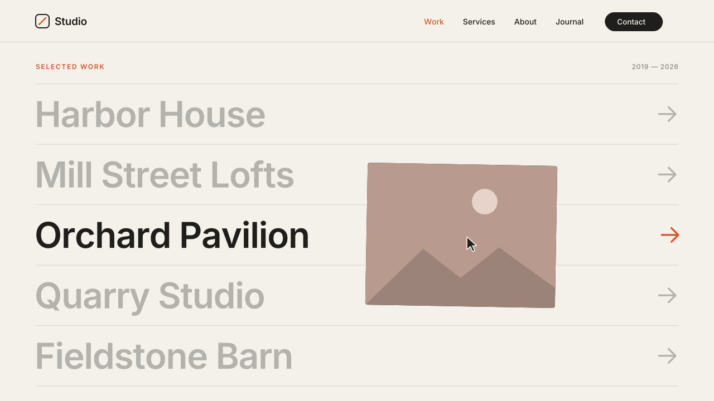

# 14 · Hover Image Reveal List

A portfolio or services index as a list of big links. Hover a row and its
image floats in under the cursor, follows it with a soft lag and tilts a
little as you move. The other rows fade back, and the row's arrow nudges
right and turns accent. The links live in a normal Text Block and the images
are normal Image Blocks, so the client edits both like any other content.
Version **1.0.0** · Status: **beta: tested in real Chrome on a mock 7.1 page; not yet on a live site**



---

# Part 1 — Basic install

## Overview

- **Editable natively.** Row names and links come from one Text Block. Images
  come from Image Blocks you upload as normal. No code edits for content changes.
- One image per row, in the same order as the links.
- Keyboard users get the same preview: Tab to a link and its image shows
  beside the row.
- **Phones, tablets and narrow windows** (touch screens, or under 768px):
  no floating image. Each row shows its own image as a small thumbnail at
  the start of the row. Nothing hides behind a hover the visitor cannot do.
- Switches off fully while you edit. In the editor you see the plain Text
  Block and every Image Block, and you can move and resize them all.
- Visitors with "reduce motion" on see the image fade in at a fixed spot
  beside the row. It does not follow the cursor and does not tilt.
- If the script fails or is blocked, the page shows the plain Text Block and
  the Image Blocks as you placed them.

Requires the **Core plan or higher** (Code Injection).

## Step 1 — Installation

Settings → Developer Tools → Code Injection → **Footer**. Paste
[`snippets/footer-injection.html`](snippets/footer-injection.html). Do this once per site.

## Step 2 — Build the section

1. Add a **Text Block**. Put each project or service on its own line
   (a new paragraph per line) and link each line to its page.
   One link per line.
2. Add one **Image Block** per line, in the same order. Upload the images as
   usual. 4:3 landscape images fit the floating frame best.
3. Put the Image Blocks somewhere small. They are hidden on the live site but
   they keep their place in the grid. The cleanest way: stack them all on top
   of each other in one small cell beside the list (Fluid Engine lets blocks
   overlap). Do the same in the **mobile layout**, or they leave a gap under
   the list on phones.
4. In the same section, add a **Code Block** and paste
   [`snippets/code-block-marker.html`](snippets/code-block-marker.html).
   The Code Block shows nothing on the live site.

**Which image goes with which row?** If an Image Block has a click-through
link that matches a row's link, they pair. Every other image pairs in the
order the Image Blocks were added to the section. If the order is wrong,
give each Image Block the same click-through link as its row. That pairing
never breaks.

**Which Text Block?** By default the **first** Text Block in the section. If
there is a heading Text Block above the list, add `data-source="2"` to the
marker.

## Step 3 — Test

- Save and exit the editor. View the page while logged out, or in a private window.
- Hover each row. The right image shows, follows the cursor, and the other
  rows fade back.
- Press Tab until a link is focused. Its image shows beside the row.
- Open the page on a phone. Each row has a thumbnail.
- Open the editor. The list is plain text again and every Image Block shows.

## Settings (optional)

Each marker can carry its own settings:

| Attribute | Default | Values |
|---|---|---|
| `data-source` | `1` | which Text Block in the section holds the links |
| `data-big-type` | `true` | `false` = keep the Text Block's own font size and weight |
| `data-dim` | `true` | `false` = do not fade the other rows |
| `data-ease` | `0.14` | follow speed, `0.05` (lazy) to `0.4` (tight) |
| `data-tilt` | `0.35` | tilt per unit of speed. `0` = no tilt |
| `data-max-tilt` | `8` | tilt limit in degrees |

To change the defaults for the whole site, paste this **above** the Footer snippet:

```html
<script>
  window.SwtlHoverList = { ease: 0.1, tilt: 0.5, breakpoint: 1024 };
</script>
```

`breakpoint` (default `768`) is the window width under which every visitor
gets the thumbnail version.

---

# Part 2 — Styling

Colors come from the three variables that all SWTL motion presets share. Set
them once in **Design → Custom CSS**:

```css
:root {
  --swtl-paper: #F4F1EA;
  --swtl-ink: #1F1E1C;     /* frame color while an image loads */
  --swtl-accent: #D4552B;  /* arrow on hover */
}
```

Row text uses the Text Block's own color. List-only knobs:

```css
:root {
  --swtl-hl-size: clamp(30px, 5vw, 64px); /* row type size (with big type on) */
  --swtl-hl-weight: 600;
  --swtl-hl-pad: .3em;                    /* space above and below each row */
  --swtl-hl-line: rgba(31,30,28,.18);     /* row dividers */
  --swtl-hl-dim: .3;                      /* opacity of the other rows */
  --swtl-hl-arrow: .62em;                 /* arrow size */
  --swtl-hl-w: 340px;                     /* floating image width */
  --swtl-hl-ratio: 4 / 3;                 /* floating image shape */
  --swtl-hl-radius: 4px;
  --swtl-hl-thumb: 64px;                  /* mobile thumbnail width */
}
```

Big type changes the size on the live site only. The editor shows the Text
Block's own style. To make the editor look close, set each line to Heading 2,
or set `data-big-type="false"` and style the list with Squarespace's own
font settings.

Row knobs work per section: `[data-section-id="…"] { --swtl-hl-dim: .15; }`.
The floating image lives outside the section, so set `--swtl-hl-w`,
`--swtl-hl-ratio` and `--swtl-hl-radius` on `:root`.

---

# Part 3 — For developers

| Item | Value |
|---|---|
| Namespace | `swtl-hl-` (classes, CSS variables) · marker `data-swtl-hoverlist` · config `window.SwtlHoverList` |
| Lifecycle | DOMContentLoaded → per marker: Text Block (`data-source`) → every `a[href]` is a row (its `p`/`h*`/`li`, or the link itself when a paragraph holds several) → pair Image Blocks (click-through `href` match first, then DOM order) → add classes, arrow `<span>`, and either one `.swtl-hl-float` on `body` (hover) or a `.swtl-hl-thumb` per row (touch) → `html.swtl-hl-on` hides the paired Image Blocks' `.fe-block` with `visibility:hidden` |
| Mode | `(hover: hover) and (pointer: fine) and (min-width: 768px)` → floating image; otherwise thumbnails. Rebuilds when that media query flips |
| Follow | rAF: `x += (target − x) × 0.14`; `rot += (clamp(dx × 0.35, ±8°) − rot) × 0.15`; loop stops when settled. Snaps to the cursor if it was hidden for > 600 ms |
| Reveal | `clip-path: inset(100% 0 0 0) → inset(0)` + `scale(.82 → 1)` 0.55s `cubic-bezier(.22,1,.36,1)`, opacity 0.3s. Swap: image opacity 0.35s, `scale(1.12 → 1)` 0.7s |
| Focus | `focus` on a link → image pinned beside its row (62% across, vertically centered); `focusout` leaving the list hides it; scroll keeps it pinned |
| Image source | `currentSrc`, else Squarespace `data-src` + `?format=1000w` (lazy images that never loaded) |
| Editor guard | exits when framed; `MutationObserver` on `body` class: `sqs-edit-mode-active` / `sqs-is-page-editing` → full teardown (float, arrows, thumbnails, listeners, every class removed; Text Block markup restored byte for byte); leaving edit mode → re-init |
| Inline styles | only `transform` on the float (not a Squarespace element). Nothing is written on Squarespace elements |
| Reduced motion | no follow, no tilt, no clip or scale: the image fades in at the pinned spot |
| Size | 11.6 KB unminified (over the 8 KB budget: pairing, two display modes, focus and reduced-motion paths) |
| Dependencies | none |

Files: `snippets/` (paste-in), `scene.py` (video; runs the snippet's event
and rAF logic on a 60 Hz simulation with the same constants and curves),
`checks.py` (12 timed frame checks), `browser.test.mjs` (29 real-Chrome
checks: pairing order, hover, follow lag and tilt, leave, focus and Tab,
touch at 1024 and 390 px, the 768 px switch, editor teardown, editor frame,
reduced motion).

---

# Part 4 — Support

## Troubleshooting

| Problem | Fix |
|---|---|
| Nothing happens, the Image Blocks show | The marker Code Block is in a different section, or you are viewing inside the editor. Check while logged out. |
| A row shows the wrong image | Give that Image Block the same click-through link as its row. Linked images always pair with the matching row. |
| A row has no image | There are fewer Image Blocks than links. Add one. |
| Blank gap where the images were | Hidden images keep their grid space. Stack them in one small cell, on desktop and in the mobile layout. |
| The wrong text became the list | Set `data-source="2"` (or 3…) on the marker. |
| Rows look small in the editor | Big type applies on the live site only. See Part 2. |
| Floating image sits under the header | Raise it: `.swtl-hl-float { z-index: 100000; }` |

## Deployed on

— (not yet)
