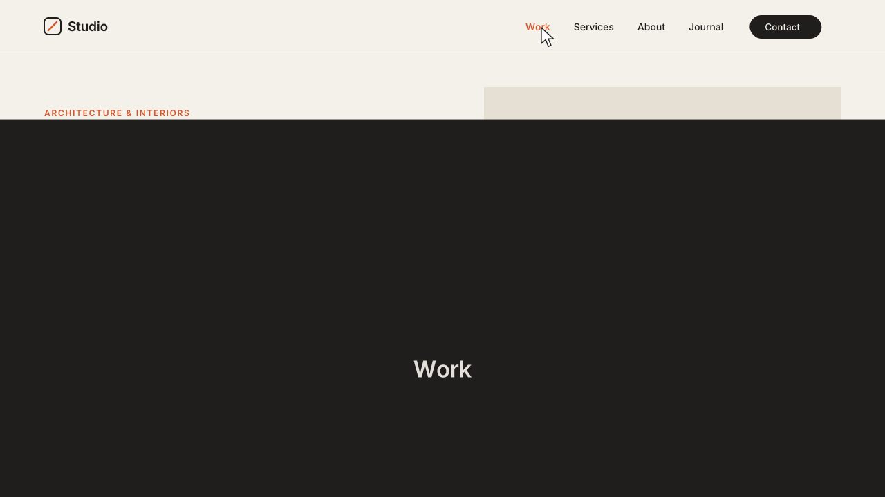

# 15 · Page Transition Wipe

A sitewide page-to-page transition. Click an internal link: an ink panel wipes
up over the page with the link's name on it, then the browser goes to the next
page. That page starts covered and the panel wipes up and off as soon as its
HTML is ready.
Version **1.0.0** · Status: **beta: tested in real Chrome on mock 7.1 pages over a local server; not yet on a live site**



---

# Part 1 — Basic install

## Overview

- Works on a normal multi-page Squarespace 7.1 site. Every page is a real,
  full page load; nothing is fetched in the background.
- Wipe up over the old page: 0.5s. Wipe off the new page: 0.6s, starting as
  soon as the HTML is parsed (it does not wait for images).
- The panel shows the clicked link's text ("Work", "About"). You can show a
  fixed wordmark instead, or nothing.
- Only plain left-clicks on links to another page of the same site get the
  wipe. Everything else navigates as normal (see the list below).
- Fail-safes: the next page always reveals within 2.5 seconds, the browser
  always navigates even if the animation breaks, and the panel never stays
  stuck after Back/Forward.
- Never runs inside the Squarespace editor.
- Visitors with "reduce motion" on get plain, instant navigation.
- Removes itself from the page when done. No classes or styles are left behind.

Requires the **Core plan or higher** (Code Injection).

### Links that never get the wipe

| Link | Why |
|---|---|
| Ctrl / Cmd / Shift / Alt + click, middle click | the visitor wants a new tab or window |
| `target="_blank"` (Open in new tab) | stays on this page |
| `download` links, links to images, PDFs, ZIPs, video, `/s/…` files | not a page |
| `#anchor` links on the same page | scroll, not navigation |
| `mailto:` and `tel:` | open another app |
| other domains | the next page cannot finish the wipe |
| `/cart`, `/checkout`, `/commerce`, `/account`, `/config` | Squarespace commerce and admin flows |
| anything inside a gallery or lightbox | Squarespace opens these in a lightbox |
| `data-swtl-pt="off"` on the link or any parent | your own opt-out |

## Step 1 — Installation

Settings → Developer Tools → Code Injection → **Header**. Paste
[`snippets/header-injection.html`](snippets/header-injection.html).

Header, not Footer: the next page must be covered from its first paint, or
visitors see a flash of it before the panel.

## Step 2 — Test

- Open the site in a private window. Click a nav item: the panel wipes up,
  the next page loads under it, and the panel wipes off.
- Press Back: the previous page shows with no panel.
- Ctrl/Cmd-click a nav item: a new tab opens and the current page does not change.

## Step 3 — Opt links out (optional)

To leave a link alone, add `data-swtl-pt="off"` to it. In Squarespace, the
easiest place is around a group of links in a Code Block:

```html
<div data-swtl-pt="off">
  <a href="/members">Members area</a>
</div>
```

To set the panel text for one link only, add `data-swtl-pt-label="Our work"`.

For links you cannot edit (a plugin, a commerce block), use the `ignore`
setting below with a CSS selector.

## Settings (optional)

Paste this **above** the snippet in the same Header box to change behavior
without touching the code:

```html
<script>
  window.SwtlPageTransition = {
    label: 'link',      // 'link' = clicked link text · 'none' · or a fixed word, e.g. 'Studio'
    speed: 1,           // 1.25 = 25% faster, 0.8 = slower
    maxWait: 2500,      // ms: next page reveals by now even if its HTML is slow
    stuckAfter: 6000,   // ms: drop the panel if the browser did not leave the page
    ignore: ''          // extra CSS selector of links to leave alone, e.g. '.header-actions a'
  };
</script>
```

Set `enabled: false` to switch the transition off without removing the code.

## Using it with a preloader (01–03)

They work together. The transition only covers a page load that it started
with a click, so the first visit shows the preloader and each later click
shows the wipe. Keep the preloader on its default `oncePerSession: true`. If
the preloader plays on every page, the visitor sees both on each click.

---

# Part 2 — Styling

Colors come from the CSS variables shared by every SWTL motion preset. Set
them once in **Design → Custom CSS**:

```css
:root {
  --swtl-ink: #1F1E1C;     /* panel color */
  --swtl-paper: #F4F1EA;   /* label color */
  --swtl-pt-panel: #1F1E1C;               /* optional: panel color for this preset only */
  --swtl-pt-label: #F4F1EA;               /* optional: label color for this preset only */
  --swtl-pt-size: clamp(22px, 2.6vw, 34px); /* label size */
  --swtl-pt-font: inherit;                /* label font; default = the site's body font */
}
```

To follow the site's own theme colors instead, use Squarespace's variables:

```css
:root {
  --swtl-ink: hsl(var(--black-hsl));
  --swtl-pt-panel: hsl(var(--accent-hsl));
}
```

During the short moment between pages, the label sits on the plain cover and
uses the system font. Set `--swtl-pt-font` to the site's heading font name
(for example `"Inter", sans-serif`) so both match exactly.

---

# Part 3 — For developers

| Item | Value |
|---|---|
| Namespace | `swtl-pt-` (ids, classes, keyframes, CSS vars) · sessionStorage key `swtlPtCover` · config `window.SwtlPageTransition` · opt-out `data-swtl-pt="off"` · per-link label `data-swtl-pt-label` |
| Leaving | one bubbling `click` listener on `document` (runs after Squarespace's own handlers, so `defaultPrevented` lightbox clicks are skipped) → `preventDefault` → `#swtl-pt-panel` from `translateY(100%)` to `0` → on `transitionend` **or** a timer at 0.58s (whichever comes first) set the flag `{t, l}` and `location.assign()` |
| Arriving | the head script reads and deletes the flag; if it is under 10s old it adds `html.swtl-pt-cover` (a `::before` cover with the label via `--swtl-pt-text`) before first paint → on `DOMContentLoaded` (or `maxWait` 2.5s) swaps in the panel and wipes it to `translateY(-100%)` → node removed |
| Timing | wipe up 0.5s · label in 0.35s from 0.15s (12px rise) · navigate at the end of the wipe · next page: hold 0.08s, wipe off 0.6s, label fade 0.25s |
| Easing | panel `cubic-bezier(.76,0,.24,1)` both ways · label in `cubic-bezier(.22,1,.36,1)` |
| bfcache | `pageshow` with `persisted: true` removes the panel and the flag, so Back/Forward never shows a stuck cover (tested with a real bfcache restore) |
| Fail-safes | any error before `preventDefault` → plain browser navigation; any error after → navigate at once; storage blocked → navigate, next page uncovered; no navigation (204, download) → panel removed after `stuckAfter`; slow HTML → reveal at `maxWait` |
| Motion | `transform` and `opacity` only. No Squarespace element is touched. |
| Editor guard | exits when `window.self !== window.top` (the editor frames the site); checks `body.sqs-edit-mode-active` / `body.sqs-is-page-editing` on each click, and a MutationObserver tears down if edit mode starts mid-transition |
| Reduced motion | no wipe and no cover; plain navigation |
| z-index | 2147483000–1, above the 01–03 preloaders (99998–99999) |
| Size | ~9.8 KB (over the 8 KB budget: skip rules, bfcache and fail-safe handling; no inline art) |
| Dependencies | none (no GSAP, no fonts, no network requests) |

Files: `timing.py` (timing and easing curves, shared with the video),
`snippet.template.html` → `build_snippet.py` → `snippets/header-injection.html`,
`scene.py` (video), `checks.py` (8 timed frame checks), `browser.test.mjs`
(45 real-Chrome checks on a local http server, incl. 16 skip cases, a real
bfcache restore, the slow-HTML fail-safe and a 204 stuck guard).

---

# Part 4 — Support

## Troubleshooting

| Problem | Fix |
|---|---|
| Next page flashes before the panel | The snippet is in the Footer. Move it to the Header. |
| A link should not wipe | Add `data-swtl-pt="off"` to it or a parent, or add a selector to `ignore`. |
| A lightbox opens behind the panel | The lightbox link is outside a gallery container. Add `data-swtl-pt="off"` or an `ignore` selector. |
| Preloader and wipe both play on every click | Set the preloader back to `oncePerSession: true`. |
| Label font changes for a moment between pages | Set `--swtl-pt-font` to the site's font (Part 2). |
| Nothing happens | You are viewing inside the editor frame, or "reduce motion" is on in the OS. Use a private window on the live URL. |

## Deployed on

— (not yet)
