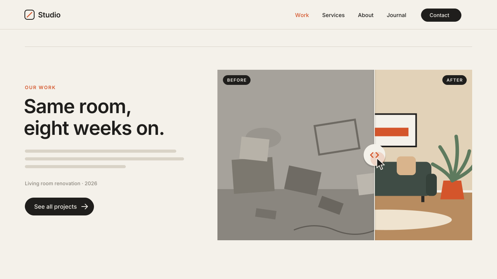

# 16 · Before / After Slider

Turns two ordinary image blocks into one before/after comparison. The after
photo sits on top of the before photo, and a round handle on a thin divider
lets visitors drag between them. The first time the slider scrolls into
view, the divider nudges from 50% to 35% and back, so people see that it moves.
Version **1.0.0** · Status: **beta: tested in real Chrome on a mock 7.1 page; not yet on a live site**



---

# Part 1 — Basic install

## Overview

- Built for contractors, design-build, landscaping, cleaning and medical
  aesthetics: any "look what we did" photo pair.
- Uses two **native image blocks**. You upload, crop and replace photos in
  the editor as normal. No code holds the images.
- The first (before) block becomes the slider. It keeps its own size and
  crop. Nothing sets a height or width.
- The second (after) block is hidden only while the slider runs. In the
  editor, both blocks show and stay editable.
- Works with a mouse, touch and pen. Keyboard users can tab to the handle and
  use the arrow keys (5% per press), **Home** and **End**.
- Optional "Before" / "After" labels, from the marker or from the images'
  alt text.
- Visitors with "reduce motion" on get no intro nudge. The slider still works.

Requires the **Core plan or higher** (Code Injection).

## Step 1 — Installation

Settings → Developer Tools → Code Injection → **Footer**. Paste
[`snippets/footer-injection.html`](snippets/footer-injection.html).

Footer, not Header: the script needs the page content to exist, and it does
nothing until a section asks for it.

## Step 2 — Add the two photos

In one Fluid Engine section:

1. Add an **Image block** with the **before** photo. Size and crop it the
   way you want the slider to look. This block becomes the slider.
2. Add a second **Image block** with the **after** photo, below or to the
   right of the first one. Use the same crop ratio so the two photos line up.
3. Give both photos real alt text (for example "Kitchen before renovation").

The after block keeps its place on the grid while it is hidden, so the live
page shows an empty space where it sits. Two ways to handle that:

- **No gap:** drag the after block on top of the before block, same size and
  position, then use the block's arrange option **Send backward**. In the editor the before
  block stays on top and easy to select.
- **Simple:** make the after block small and put it where a gap does not
  matter (for example, beside a text block).

## Step 3 — Mark the section

Add a **Code Block** anywhere in the same section and paste
[`snippets/code-block-marker.html`](snippets/code-block-marker.html):

```html
<div data-swtl-beforeafter data-before-label="Before" data-after-label="After" hidden></div>
```

The script takes the first two image blocks in reading order (top to bottom,
then left to right): the first is "before", the second is "after". Every
attribute is optional:

| Attribute | Values | Default |
|---|---|---|
| `data-pair` | two block ids, before then after: `"block-yui_123 block-yui_456"` | first two image blocks |
| `data-start` | divider start position, % of the width showing "before" | `50` |
| `data-hint` | `false` = no intro nudge | `true` |
| `data-labels` | `true`, `false`, `alt` (use each image's alt text) | `true` |
| `data-before-label` | label text | `Before` |
| `data-after-label` | label text | `After` |
| `data-aria-label` | slider name for screen readers | `Before and after comparison` |

**More than one pair in a section:** add one marker per pair. Each marker
takes the next two unused image blocks, or use `data-pair` to choose them.
To find a block id, right-click the image on the live page → Inspect, and copy
the `id` of the `.sqs-block` (it starts with `block-`).

## Step 4 — Test

- Log out (or use a private window) and scroll to the section. The divider
  nudges left and back once.
- Drag the handle, or click anywhere on the photo. On a phone, swipe sideways
  on the photo. Swiping up or down still scrolls the page.
- Press **Tab** until the handle shows an outline, then use the arrow keys.
- Open the page editor. Both image blocks must show and be editable.

## Settings (optional)

Paste this **above** the snippet in the same Footer box to change the
defaults for every marked section:

```html
<script>
  window.SwtlBeforeAfter = {
    start: 50,              // % of the width showing "before"
    hint: true,             // intro nudge 50 > 35 > 50, once
    labels: true,           // true | false | 'alt'
    beforeLabel: 'Before',
    afterLabel: 'After',
    step: 5,                // % per arrow key
    threshold: 0.5          // share of the slider on screen before the nudge
  };
</script>
```

Marker attributes override these settings for their own section.

---

# Part 2 — Styling

Colors come from the CSS variables shared by every SWTL motion preset. Set
them once in **Design → Custom CSS**:

```css
:root {
  --swtl-paper: #F4F1EA;   /* handle, divider line, label text */
  --swtl-ink: #1F1E1C;     /* chevrons, label background */
  --swtl-accent: #D4552B;  /* chevrons on hover / drag, focus ring */
}
```

Preset-only overrides:

| Variable | Controls | Falls back to |
|---|---|---|
| `--swtl-ba-handle` | handle circle | `--swtl-paper` |
| `--swtl-ba-icon` | chevrons | `--swtl-ink` |
| `--swtl-ba-line` | divider line | `--swtl-paper` |
| `--swtl-ba-label-bg` | label pill | `--swtl-ink` |
| `--swtl-ba-label` | label text | `--swtl-paper` |

To follow the site's own theme colors:

```css
:root {
  --swtl-paper: hsl(var(--white-hsl));
  --swtl-ink: hsl(var(--black-hsl));
  --swtl-accent: hsl(var(--accent-hsl));
}
```

A smaller handle for a narrow column:

```css
[data-section-id="abc123"] .swtl-ba-handle { transform: scale(.8); }
```

The handle grows 8% and its chevrons turn accent on hover and while dragging.

---

# Part 3 — For developers

| Item | Value |
|---|---|
| Namespace | `swtl-ba-` (classes, CSS variables) · marker `data-swtl-beforeafter` · config `window.SwtlBeforeAfter` |
| Lifecycle | DOMContentLoaded → find markers → `closest('section.page-section')` → pair (`data-pair` ids, else first two free `.image-block`s by rendered top (8px row tolerance), then left) → inject `div.swtl-ba-ui` into the before block's `.fluid-image-container` (fallback: the img's parent) → add `html.swtl-ba-on` → IntersectionObserver (threshold 0.5, once) plays the hint |
| Layers | `.swtl-ba-after` holds a clone of the after `` (`object-fit: cover`, `object-position` copied from the source, alt kept) clipped with `clip-path: inset(0 0 0 calc(var(--swtl-ba-pos) * 1%))` · `.swtl-ba-line` · `.swtl-ba-handle` · two `aria-hidden` labels |
| Slider | handle is `role="slider"`, `tabindex="0"`, `aria-valuemin/max` 0/100, `aria-valuenow`, `aria-valuetext` ("45% before"). Keys: arrows ±5, Home 0, End 100 |
| Pointer | Pointer Events on the overlay (mouse, touch, pen) with pointer capture; `touch-action: pan-y` keeps vertical page scroll on touch |
| Hint | `--swtl-ba-pos` 50 → 35 over 0.55s, hold 0.15s, → 50 over 0.70s (cosine ease ≈ `cubic-bezier(.65,0,.35,1)`), rAF-driven, cancelled by any drag or key |
| What it writes | classes `swtl-ba-host` (adds `position: relative` to the image container), `swtl-ba-used`, `swtl-ba-src` (`visibility: hidden` on the after block). The only inline style is `--swtl-ba-pos` on its own overlay. No height, width or grid placement |
| Editor guard | exits when framed (`window.self !== window.top`); a MutationObserver on `body` class tears down on `sqs-edit-mode-active` / `sqs-is-page-editing` (removes the overlay, classes and html class, cancels the hint) and re-inits on exit |
| Fail-safe | the after block hides only under `html.swtl-ba-on`. No script or framed → both images show as normal |
| Lazy images | if the after image loads later (Squarespace lazy loading), its `load` event updates the clone |
| Size | ~11.0 KB unminified (over the 8 KB budget; see meta.json) |
| Dependencies | none (no GSAP, no fonts, no network requests) |

Files: `timing.py` (hint timing shared by the video and the checks),
`scene.py` (video), `checks.py` (19 timed frame checks, including a check
that the snippet uses the same numbers as `timing.py`), `browser.test.mjs`
(46 real-Chrome checks: pairing, mouse/touch/keyboard, sizes vs no script,
editor teardown, frame guard, reduced motion).

---

# Part 4 — Support

## Troubleshooting

| Problem | Fix |
|---|---|
| Nothing happens | No marker in the section, fewer than two image blocks, or you are viewing inside the editor frame. Log out or use a private window. |
| Wrong photo is "before" | The higher (or, on the same row, the left) block is "before". Move the blocks, or set `data-pair="beforeId afterId"`. |
| Empty space on the live page | That is the hidden after block's grid space. Overlap it on the before block (Step 2). |
| Photos do not line up | Give both image blocks the same crop ratio. The after photo fills the before block's frame with `object-fit: cover`, using its own focal point. |
| The image link or lightbox stopped working | Expected: the slider takes every click on the photo. Put the link on a button instead. |
| Page will not scroll when I swipe on the photo | Vertical swipes scroll. Mostly sideways swipes move the slider. |

## Deployed on

— (not yet)
