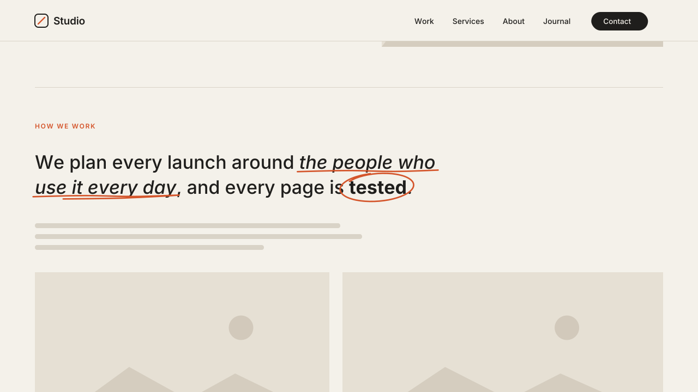

# 17 · Marker Highlight & Underline Draw

Italic (or bold) words in a section get a hand-drawn mark as they scroll into
view: a marker band behind the text, a scribbled underline, or a rough circle.
Version **1.0.0** · Status: **beta: tested in real Chrome on a mock 7.1 page; not yet on a live site**



---

# Part 1 — Basic install

## Overview

- Works on the normal Squarespace **Text block**. You mark words with the
  editor's own **Italic** (or **Bold**) button. No code in the text.
- Three styles:
  - **highlight**: a marker band behind the lower part of the words, drawn
    left to right.
  - **underline**: a scribbled underline drawn under the words, with a small
    return swoosh at the end.
  - **circle**: a rough loop drawn around one short word.
- Turn it on per section: only sections with the marker Code Block get marks.
- Each mark draws once, when it scrolls into view. Several marks in one
  section draw one after another.
- Phrases that wrap onto two lines get a mark on each line.
- The words stay real text. Italic and bold keep their meaning for screen
  readers and search engines.
- Marks follow the text when the window is resized.
- Never runs inside the Squarespace editor. If you open the editor on a live
  page, it removes everything it added, so the text is **exactly** what you typed.
- Visitors with "reduce motion" on see the marks already drawn, with no motion.

Requires the **Core plan or higher** (Code Injection).

## Step 1 — Installation

Settings → Developer Tools → Code Injection → **Footer**. Paste
[`snippets/footer-injection.html`](snippets/footer-injection.html).

Footer, not Header: the script reads the page content, so it must load after it.

## Step 2 — Mark the sections

In each section that should get marks:

1. Add a **Code Block** anywhere in the section. Make it small; it shows nothing.
2. Paste [`snippets/code-block-marker.html`](snippets/code-block-marker.html):

   ```html
   <div data-swtl-marker data-style="highlight" hidden></div>
   ```

3. Change `highlight` to `underline` or `circle` if you want.
4. Save.

## Step 3 — Mark the words

In a Text block of that section, select the words and press **Italic**.
That is all. Headings 1–4 and paragraphs all work.

To use **Bold** words instead, add `data-target="strong"` to the marker:

```html
<div data-swtl-marker data-target="strong" data-style="circle" hidden></div>
```

Both in one section? Pair them with commas. Here italic words get an
underline and bold words get a circle:

```html
<div data-swtl-marker data-target="em, strong" data-style="underline, circle" hidden></div>
```

Tips:
- **circle** is for one short word (up to 16 letters). A longer phrase, or a
  word that wraps, gets an underline instead.
- One or two marks per section reads best. Marks on every line lose their point.

## Step 4 — Test

- Open the published page in a private window (not the editor preview).
- Marks in the first screen draw on load. Scroll down: each mark draws when
  its words are well on screen.
- Make the window narrow → the marks move with the text.
- Open the page in the editor → the text is normal and fully editable.

## Settings (optional)

Paste this **above** the snippet in the same Footer box:

```html
<script>
  window.SwtlMarker = {
    style: 'highlight',   // default style when the marker has no data-style
    target: 'em',         // 'em' = italic words, 'strong' = bold words
    duration: 0.8,        // s to draw one mark (circle takes 15% longer)
    stagger: 0.25,        // s between marks in one section
    delay: 0.15,          // s after the words come into view
    weight: 0.08,         // line thickness, as a share of the text size
    circleMax: 16,        // longer words get an underline instead of a circle
    keepItalic: true      // false = marked words lose their italic/bold look
  };
</script>
```

One section different? Put the setting on its marker instead:

```html
<div data-swtl-marker data-style="underline" data-duration="1.1" data-stagger="0.4" hidden></div>
```

---

# Part 2 — Styling

Colors come from the variables shared by every SWTL motion preset. Set them
in **Design → Custom CSS**:

```css
:root {
  --swtl-accent: #D4552B;      /* underline + circle color, and the band tint */
  --swtl-mh-color: #D4552B;    /* underline + circle only (defaults to the accent) */
  --swtl-mh-band: rgba(212, 85, 43, .38);  /* highlight band color */
  --swtl-mh-height: 35%;       /* band height, share of the text height */
}
```

To follow the site's own accent color:

```css
:root { --swtl-accent: hsl(var(--accent-hsl)); }
```

A solid band (for example a bright yellow `#FFE45C`) reads as a classic
highlighter. Keep text contrast in mind: the band sits behind the words.

To drop the italic look on marked words without a script setting:

```css
em.swtl-mh-hl { font-style: normal; }
```

---

# Part 3 — For developers

| Item | Value |
|---|---|
| Namespace | `swtl-mh-` (classes, keyframes, CSS vars) · marker `data-swtl-marker` · config `window.SwtlMarker` |
| Lifecycle | Footer script → finds markers → `section.page-section` → `.sqs-html-content` → `h1–h4, p` → target `em` / `strong` → IntersectionObserver per word (`rootMargin 0 0 -15% 0`, once) → draw |
| Highlight | class `.swtl-mh-hl` on the `em`/`strong`: `linear-gradient` background at `0 88%`, `background-size` 0% → 100% × 35%, `box-decoration-break: clone` so every line fragment gets its own band |
| Underline / circle | one `svg.swtl-mh-svg` overlay per Text block, appended to its `.sqs-block` (outside `.sqs-html-content`), `aria-hidden`, `pointer-events: none`. Geometry from `getClientRects()` → one smooth path per line (Catmull-Rom → cubic). Stroke draw = `stroke-dashoffset` from the real `getTotalLength()` to 0; wrapped lines draw in sequence, time split by length |
| Timing | 0.8s `cubic-bezier(.7,0,.2,1)` per mark (circle × 1.15) · 0.15s after entry · 0.25s between marks in a section |
| Resize | debounced 150 ms + `document.fonts.ready` → paths rebuilt from fresh `getClientRects()`; drawn marks stay drawn, pending ones stay hidden |
| Accessibility | words stay real text (`textContent` unchanged); overlays `aria-hidden`; reduced motion → marks drawn at once, no animation |
| Editor guard | exits when framed; MutationObserver on `body` class: `sqs-edit-mode-active` / `sqs-is-page-editing` → teardown restores each word's original `class` / `style` attribute (byte-identical `innerHTML`) and removes every overlay SVG; class removed → re-init |
| Hidden state | only under `html.swtl-mh-on`, which the script adds. No script → plain italic/bold text |
| Writes | `class` + `animation-delay` on target words (removed at rest), its own SVG elements. Never height, width or grid placement on Squarespace elements |
| Size | ~12.7 KB unminified (over the 8 KB budget: three styles, path geometry, resize rebuild, exact restore) |
| Dependencies | none |

Files: `scene.py` (video; geometry functions ported verbatim from the
snippet, real path lengths via svgpathtools), `checks.py` (9 timed frame
checks), `browser.test.mjs` (34 real-Chrome checks).

---

# Part 4 — Support

## Troubleshooting

| Problem | Fix |
|---|---|
| Nothing happens | The section has no marker Code Block, the words are not italic (or bold, with `data-target="strong"`), or you are in the editor. Check the published page in a private window. |
| The circle became an underline | The word is longer than 16 letters or wraps to two lines. Pick a shorter word, or raise `circleMax` in the settings. |
| Underline cuts through descenders (g, p, y) | That is the hand-drawn look. For a lower line, use `highlight`, or raise the line height of the text. |
| Marks are cut off at the edge of a block | The section or block clips overflow. Give the Text block a bit more room in Fluid Engine. |
| Band looks too strong | Set `--swtl-mh-band` to a lighter color, or `--swtl-mh-height: 25%`. |
| Bold words get a mark I did not want | Only the target set on the marker is marked. Check `data-target` on that section's marker. |

## Deployed on

— (not yet)
