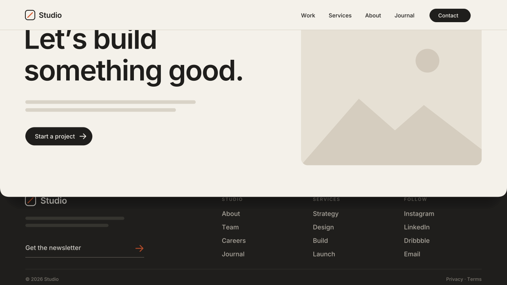

# 18 · Curtain Footer Reveal

The site footer sits still behind the page. When the visitor reaches the end
of the page, the last section scrolls up off the footer like a curtain. The
page edge has a soft shadow and rounded bottom corners, and the footer
content rises a little and fades in as it shows.
Version **1.0.0** · Status: **beta: tested in real Chrome on a mock 7.1 page; not yet on a live site**



---

# Part 1 — Basic install

## Overview

- Works on the **existing footer**. You build it as normal from footer
  sections in Fluid Engine.
- Sitewide. One paste, no Code Block, no marker.
- Nothing is locked to a height. The script adds its own empty spacer after
  the page, sized to the footer, so the page can scroll up and show it. When
  you change the footer, the spacer follows.
- Footer links, buttons and forms stay clickable when the footer shows.
- If the footer is taller than **85% of the screen**, the effect turns
  itself off and the footer scrolls as normal. A fixed footer that does not
  fit cannot scroll, so its bottom would be cut off. This is common on
  phones, and it turns back on when the footer fits.
- Turns itself off in the Squarespace editor. The footer goes back into the
  normal page flow, so you can edit and resize it as usual. Everything goes
  back on when you leave the editor.
- Visitors with "reduce motion" on still get the curtain, but the footer
  content does not rise or fade.

Requires the **Core plan or higher** (Code Injection).

## Step 1 — Installation

Settings → Developer Tools → Code Injection → **Footer**. Paste
[`snippets/footer-injection.html`](snippets/footer-injection.html).

## Step 2 — Check the footer height

Keep the footer shorter than most screens. About 250–450px tall on desktop
works well. To make it shorter, use less padding in the footer sections or
fewer rows.

## Step 3 — Test

- Open the site **logged out** (or in a private window) and scroll to the
  bottom of a page. In the editor the effect is off on purpose.
- Click a footer link. It must work.
- Make the browser short. When the footer no longer fits, it must scroll
  normally.

## Settings (optional)

Paste this **above** the snippet in the same Footer box:

```html
<script>
  window.SwtlCurtainFooter = {
    radius: 24,             // px, bottom corners of the page (0 = square)
    shadow: '0 28px 56px -18px rgba(0,0,0,.38)',  // CSS box-shadow, or 'none'
    maxFooterRatio: 0.85,   // turn off when the footer is taller than this share of the screen
    parallax: 60,           // px the footer content rises (0 = no rise, no fade)
    fade: 0.35,             // footer content opacity when the reveal starts
    background: 'auto',     // page color behind sections; 'auto' = read from the site
    zIndex: 1               // page layer; the footer sits one below it
  };
</script>
```

---

# Part 2 — Styling

The page needs a solid color so the footer cannot show through gaps. With
`background: 'auto'` the script reads the site background (body, then
`#siteWrapper`, then the last section) and uses it. If none is set, it uses
the shared variable. Set it once in **Design → Custom CSS**:

```css
:root {
  --swtl-paper: #F4F1EA;           /* page color fallback */
}
```

The footer color is the footer section's own background. Set it in its
Background panel (or a color theme), as usual. A dark footer under a light
page shows the shadow and the corners best.

---

# Part 3 — For developers

| Item | Value |
|---|---|
| Namespace | `swtl-cf-` classes · `--swtl-cf-bg / -z / -radius / -shadow / -y / -o` · `window.SwtlCurtainFooter` |
| Targets | `footer#footer-sections` (config `footer`) · `main#page` (config `page`) · `#header` / `header.header` |
| Classes added | `swtl-cf-page` on `#page` (`position: relative`, z-index, background, shadow, bottom radius) · `swtl-cf-round` (`overflow: clip`, inside `@supports`) · `swtl-cf-footer` on the footer (`position: fixed; bottom: 0; left/right: 0`, z-index one below the page) · `swtl-cf-header` (only if the header is positioned with no z-index or one ≤ the page's: lifts it one above) |
| Spacer | `div.swtl-cf-spacer[aria-hidden=true]`, inserted right after `#page`, `pointer-events: none`. Its inline `height` = `footer.offsetHeight`, kept in sync by a ResizeObserver on the footer. This is the only inline height the script writes. |
| Inline writes | custom properties on `<html>` (`--swtl-cf-bg / -z / -radius / -shadow`) and on the footer (`--swtl-cf-y / -o`, from rAF only). Never height/min-height/margin on Squarespace elements. |
| Parallax | `p = clamp((innerHeight − spacer.top) / footerHeight)` · footer `.page-section > .content-wrapper` gets `translateY((1 − p)·parallax)` and `opacity fade + (1 − fade)·p` through the two variables. Section backgrounds stay still. |
| Clicks | the spacer is a non-positioned block, so the fixed footer (positioned, z ≥ 0) paints and hit-tests above it. At the page bottom the footer is the top element at its links. |
| Skip rules | footer taller than `maxFooterRatio × innerHeight` (re-checked on resize and footer resize) · footer not at the viewport bottom after enabling (a transformed ancestor breaks `fixed`) → full teardown until the next resize |
| Lifecycle | `DOMContentLoaded` → sync. A MutationObserver on `body` class tears down on `sqs-edit-mode-active` / `sqs-is-page-editing` (spacer removed, ResizeObserver off, footer back in flow) and re-inits on exit. |
| Guards | exits when framed (`self !== top`) · reduced motion: curtain kept, no parallax/fade |
| Size | ~7.7 KB unminified |
| Dependencies | none (no GSAP) |

Files: `scene.py` (video, same math as the script), `checks.py` (8 timed
frame checks), `browser.test.mjs` (28 real-Chrome checks on a
`#siteWrapper > header#header + main#page > article.sections +
footer#footer-sections.sections > section.page-section` page with a fixed
header: spacer sizing and resize, `elementFromPoint` + click on footer links,
tall-footer skip, header guard, editor teardown, frame guard, reduced
motion).

Works with **09 Sticky Stack** on the same page: `overflow: clip` on `#page`
does not break `position: sticky`.

---

# Part 4 — Support

## Troubleshooting

| Problem | Fix |
|---|---|
| Footer scrolls normally, no curtain | The footer is taller than 85% of the screen. Make it shorter, or raise `maxFooterRatio` (the bottom of a taller footer can be cut off). |
| Footer shows through the page | A section has no background. Set a section background, or set `background` in the settings. |
| The header slides under the page | The header is not `#header` / `header.header`. Give it a z-index above 1 in Custom CSS. |
| Footer sits in the middle of the screen, or nothing happens | A template or plugin puts a `transform` on a wrapper. The script detects this and turns off. Remove that transform. |
| Corners are square | `radius` is 0, or the browser is older than Safari 16 (no `overflow: clip`). |
| Nothing happens | You are in the editor, or the footer is not `footer#footer-sections`. Test logged out. |

## Deployed on

— (not yet)
